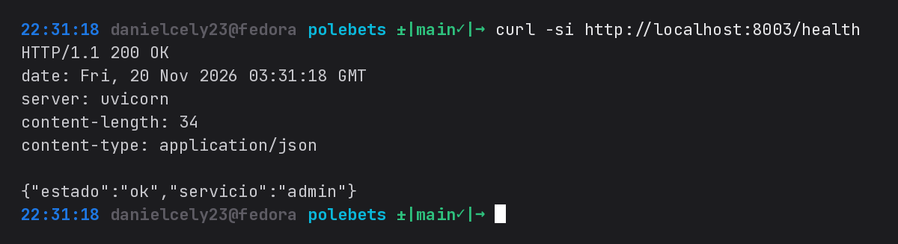
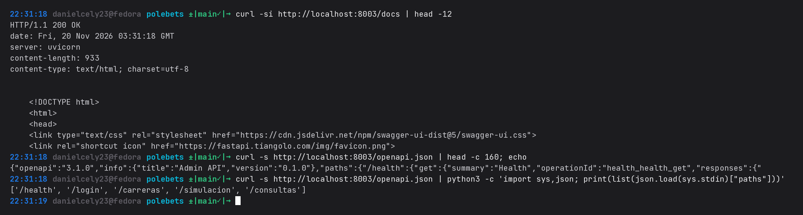
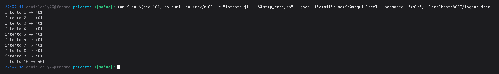
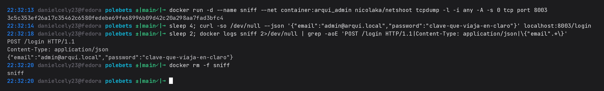
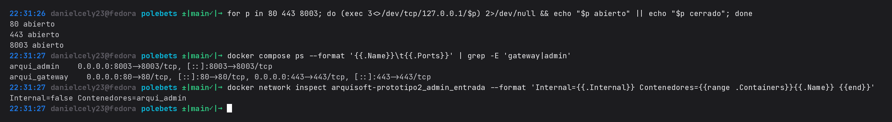
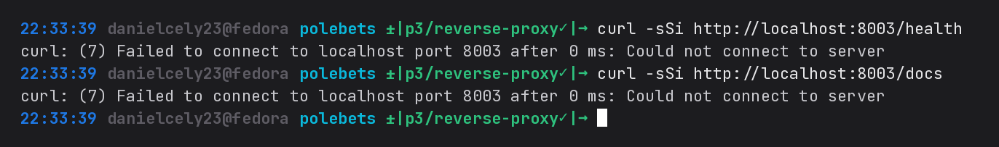

# Escenario 2 — Reverse Proxy (T3-03) y TLS en la CLI (T3-06)

**Dueño:** Daniel
**Patrón:** Reverse Proxy
**Táctica (Bass, §11.2):** *Limit access* (categoría **resistir**)
**Atributos de calidad:** Confidencialidad, integridad
**Rama de trabajo:** `p3/reverse-proxy`

> Estructura del roadmap:
> 1. El problema, justificado sobre la vista C&C y la de despliegue.
> 2. Evidencia de la vulnerabilidad (antes).
> 3. Táctica, patrón e implementación.
> 4. La misma prueba con la contramedida funcionando (después).
> 5. Qué cambia en las vistas C&C y de despliegue.
>
> Al final: riesgos y notas para el equipo.

---

## 1. El problema (antes)

Admin es el servicio más sensible del sistema: programa las simulaciones de
carrera (HU2-19) y entrega los reportes financieros (HU2-20 a HU2-23). Aun así,
era el **único servicio de lógica publicado directamente al host** (`8003:8003`),
por fuera del API Gateway.

### Sobre la vista C&C

- El conector **CLI → Admin** era REST sobre **HTTP plano** y **no pasaba por el
  Gateway**. Era la única excepción a "toda entrada pasa por el Gateway" que
  dejó el prototipo 2.
- Por eso a Admin no lo cubría **ningún control del Gateway**: ni el TLS del
  escenario 1 ni el límite de peticiones que trae el escenario 5. `POST /login`
  de Admin acepta intentos de contraseña sin freno, y la contraseña y el token
  viajan en claro.
- FastAPI publicaba **`/docs`, `/redoc` y `/openapi.json`**: el mapa completo de
  la API (rutas, cuerpos, filtros) servido a cualquiera que alcanzara el puerto.
- El Gateway anunciaba su versión exacta en la cabecera `Server: nginx/1.27.5`,
  lo que le dice a un atacante qué CVE probar.

### Sobre la vista de despliegue

- Había **dos puertas** en el host: 80/443 (Gateway) y **8003 (Admin)**.
- Admin estaba en la red **`admin_entrada`**, que **no era `internal`**: Docker
  no permite `internal: true` en una red con puertos publicados. Admin era
  entonces un nodo de borde, con salida a Internet, y a la vez tenía acceso a
  `admin_usuarios` (Usuarios) y a `broker` (RabbitMQ).
- La CLI compartía con Admin esa misma red `admin_entrada`.

### Riesgo

Cualquiera que llegue al host (LAN, máquina comprometida) puede ver la API
completa, probar contraseñas contra el login del administrador sin límite y
capturar credenciales en tránsito. Se compromete la **confidencialidad**
(reportes financieros, credenciales) y la **integridad** (programar o
desordenar simulaciones con un token robado).

---

## 2. Evidencia de la vulnerabilidad (antes)

Capturada sobre `main` en `37c7b3f` (antes de esta rama), con el stack recién
levantado:

```bash
docker compose down
git switch main
docker compose up --build -d
```

### 2.1 Admin responde directo en el 8003, sin pasar por el Gateway

```bash
curl -i http://localhost:8003/health
```
```powershell
curl.exe -i http://localhost:8003/health
```
```
HTTP/1.1 200 OK
server: uvicorn
content-type: application/json

{"estado":"ok","servicio":"admin"}
```



### 2.2 La API publica su propio mapa

```bash
curl -i http://localhost:8003/docs | head -12
curl -s http://localhost:8003/openapi.json | head -c 400
```
```powershell
curl.exe -i http://localhost:8003/docs
curl.exe -s http://localhost:8003/openapi.json
```
```
HTTP/1.1 200 OK
server: uvicorn
content-type: text/html; charset=utf-8

    <!DOCTYPE html>
    <html>
    <head>
    <link type="text/css" rel="stylesheet" href="https://cdn.jsdelivr.net/npm/swagger-ui-dist@5/swagger-ui.css">

{"openapi":"3.1.0","info":{"title":"Admin API","version":"0.1.0"},"paths":{"/health":{...},"/login":{"post":...
```

Las rutas que expone `openapi.json`:
`['/health', '/login', '/carreras', '/simulacion', '/consultas']`.



### 2.3 El Gateway revela su versión

```bash
curl -kI https://localhost/
curl -I http://localhost/
```
```powershell
curl.exe -kI https://localhost/
curl.exe -I http://localhost/
```
```
HTTP/1.1 200 OK
Server: nginx/1.27.5

HTTP/1.1 301 Moved Permanently
Server: nginx/1.27.5
Location: https://localhost/
```

### 2.4 Diez contraseñas malas seguidas: todas responden, nada frena

```bash
for i in $(seq 1 10); do
  curl -s -o /dev/null -w "intento $i -> %{http_code} en %{time_total}s\n" \
    -X POST http://localhost:8003/login -H "Content-Type: application/json" \
    -d "{\"email\":\"admin@arqui.local\",\"password\":\"mala-$i\"}"
done
```
```powershell
# PowerShell 7+
1..10 | ForEach-Object {
  curl.exe -s -o NUL -w "intento $_ -> %{http_code} en %{time_total}s`n" `
    -X POST http://localhost:8003/login -H "Content-Type: application/json" `
    -d ('{"email":"admin@arqui.local","password":"mala-' + $_ + '"}')
}
```
```
intento 1 -> 401 en 0.489687s
intento 2 -> 401 en 0.459975s
intento 3 -> 401 en 0.417051s
intento 4 -> 401 en 0.280976s
intento 5 -> 401 en 0.244886s
intento 6 -> 401 en 0.220021s
intento 7 -> 401 en 0.223543s
intento 8 -> 401 en 0.200593s
intento 9 -> 401 en 0.209970s
intento 10 -> 401 en 0.234612s
```



### 2.5 La contraseña viaja en claro

Captura del tráfico que recibe Admin (su propio espacio de red) mientras alguien
hace login por el 8003, que es el mismo canal que usaba la CLI:

```bash
docker run --rm --net container:arqui_admin nicolaka/netshoot \
  tcpdump -i any -A -s 0 -c 1 'tcp port 8003 and tcp[((tcp[12:1] & 0xf0) >> 2):4] = 0x504f5354'
# en otra terminal:
curl -s -X POST http://localhost:8003/login -H 'Content-Type: application/json' \
  -d '{"email":"admin@arqui.local","password":"clave-que-viaja-en-claro"}'
```
```powershell
docker run --rm --net container:arqui_admin nicolaka/netshoot `
  tcpdump -i any -A -s 0 -c 1 "tcp port 8003 and tcp[((tcp[12:1] & 0xf0) >> 2):4] = 0x504f5354"
# en otra terminal:
curl.exe -s -X POST http://localhost:8003/login -H "Content-Type: application/json" `
  -d '{"email":"admin@arqui.local","password":"clave-que-viaja-en-claro"}'
```
```
POST /login HTTP/1.1
Content-Type: application/json
{"email":"admin@arqui.local","password":"clave-que-viaja-en-claro"}
```



### 2.6 Puertos abiertos y red de Admin

```bash
for p in 80 443 8003; do (exec 3<>/dev/tcp/127.0.0.1/$p) 2>/dev/null && echo "$p abierto" || echo "$p cerrado"; done
docker compose ps --format "{{.Name}}\t{{.Ports}}" | grep -E "gateway|admin"
docker network inspect arquisoft-prototipo2_admin_entrada \
  --format 'Internal={{.Internal}} Contenedores={{range .Containers}}{{.Name}} {{end}}'
```
```powershell
80, 443, 8003 | ForEach-Object { "$_ " + (Test-NetConnection localhost -Port $_ -WarningAction SilentlyContinue).TcpTestSucceeded }
docker compose ps --format "{{.Name}}`t{{.Ports}}" | Select-String "gateway|admin"
docker network inspect arquisoft-prototipo2_admin_entrada `
  --format "Internal={{.Internal}} Contenedores={{range .Containers}}{{.Name}} {{end}}"
```
```
80 abierto
443 abierto
8003 abierto

arqui_admin    0.0.0.0:8003->8003/tcp, [::]:8003->8003/tcp
arqui_gateway  0.0.0.0:80->80/tcp, [::]:80->80/tcp, 0.0.0.0:443->443/tcp, [::]:443->443/tcp

Internal=false Contenedores=arqui_admin
```



---

## 3. Táctica, patrón e implementación

**Patrón: Reverse Proxy.** Un único intermediario recibe todas las peticiones
de afuera y las reenvía a los servicios internos, que dejan de ser alcanzables
directamente. Ese intermediario ya existía: el API Gateway (Nginx). Lo que
cambia es que **Admin pasa a estar detrás de él**.

**Táctica: *Limit access* (resistir).** Se reduce quién y por dónde puede llegar
a Admin: ya no tiene puerto en el host, su única red de entrada es interna y
solo la comparte con el Gateway. Además se oculta lo que no hace falta mostrar
(el mapa de la API y la versión de Nginx), y el canal de la CLI pasa a ir
cifrado y con el servidor verificado (confidencialidad e integridad en
tránsito).

### Archivos cambiados y por qué

| Archivo | Cambio | Por qué |
| --- | --- | --- |
| `services/gateway/admin.conf` | `location /api/admin/` → `http://admin:8003`, quitando el prefijo | Admin solo se publica a través del Gateway |
| `services/gateway/endurecimiento.conf` | `server_tokens off;` | Ocultar la versión de Nginx |
| `services/gateway/Dockerfile` | copia `endurecimiento.conf` a `conf.d/`; `EXPOSE 80 443` | Nivel http; documentar el 443 |
| `docker-compose.yml` | Admin sin `ports`; redes `gw_admin`, `admin_usuarios`, `broker`; nueva red `gw_admin` (`internal: true`); se elimina `admin_entrada`; Gateway en `gw_admin` y depende de Admin; la CLI va en `borde` hacia `https://gateway/api/admin` con solo el `.crt` montado | Una sola puerta, Admin fuera del borde |
| `services/admin/app/main.py` | `docs_url=None, redoc_url=None, openapi_url=None` | No publicar el mapa de la API |
| `services/admin/tests/test_ocultamiento.py` | `/docs`, `/redoc`, `/openapi.json` → 404 | Que no vuelva a aparecer |
| `services/cli/Cargo.toml`, `Cargo.lock` | `reqwest` con `rustls-tls` (ring, sin OpenSSL ni aws-lc-rs) | HTTPS en la CLI sin dependencias de sistema |
| `services/cli/src/*.rs`, `tests/en_vivo.rs` | URL por defecto `https://localhost/api/admin`; `POLEBET_CA_CERT`; aviso si la URL es `http://`; error de certificado distinto del de conexión | T3-06 |
| `services/cli/Dockerfile` | `POLEBET_ADMIN_URL=https://gateway/api/admin`, `POLEBET_CA_CERT=/certs/polebet.crt` | La CLI es un cliente externo más |
| `scripts/generar-certs.sh`, `scripts/generar-certs.ps1` | Certificado autofirmado con SAN `localhost`, `gateway`, `127.0.0.1`, `CA:FALSE` y `serverAuth` | La CLI en Docker llama a `gateway`; rustls exige un certificado de servidor |

### Decisiones

- **Prefijo `/api/admin/` y no `/admin/`.** `/admin` ya es una ruta de la SPA
  (HU-11/12) y la sirve el Front. En Nginx gana el prefijo más largo, así que
  `location /api/admin/` no choca con `location /api/` de `rutas.conf`
  (ninguno es regex ni lleva `^~`). Ejemplos: `/api/admin/login` → Admin
  `/login`, `/api/admin/carreras` → `/carreras`.
- **El Gateway no hace `auth_request` en `/api/admin/`.** El `auth_request` de
  `rutas.conf` lee la cookie `session` de los jugadores, pero la CLI manda
  `Authorization: Bearer <token>`. Admin ya valida ese token en **cada**
  petición contra Usuarios (`GET /internal/auth`) y exige rol `admin`
  (`services/admin/app/sesion.py`). Nginx reenvía `Authorization` tal cual. El
  Gateway aporta el punto único de entrada, el TLS, el ocultamiento y el lugar
  donde el escenario 5 pondrá el límite de intentos.
- **`X-User-Id` y `X-User-Rol` vacíos.** Un `location` con `proxy_set_header`
  propios no hereda los del `server`, así que se vuelven a neutralizar en
  `admin.conf`.
- **Variable + `resolver`** (`set $admin http://admin:8003`), igual que en
  `rutas.conf`: Nginx arranca aunque Admin todavía no esté arriba.
- **Red `gw_admin`, `internal: true`, solo Gateway y Admin.** Admin ya no
  publica puertos, así que su red de entrada puede ser interna: pierde la
  salida a Internet y deja de ser un nodo de borde.
- **`server_tokens off` en un archivo propio a nivel http.** Dentro de
  `admin.conf` solo aplicaría al server 443/8080, y el server del 80 (la
  redirección a HTTPS) seguiría mostrando la versión. `nginx.conf` es del
  escenario 1 y no se tocó.
- **`POLEBET_CA_CERT` en vez de saltarse la verificación.** La CLI agrega el
  certificado autofirmado como raíz de confianza
  (`ClientBuilder::add_root_certificate`). Nunca se usa
  `danger_accept_invalid_certs`. Si la variable no está definida, la CLI usa las
  raíces públicas de Mozilla (`webpki-roots`), lo que sirve para un certificado
  real en el futuro. Si el archivo no existe o no es un certificado, la CLI sale
  con un error claro antes de abrir la interfaz.
- **SAN `DNS:gateway`.** Dentro de Docker la CLI llama a `https://gateway`; sin
  ese nombre en el certificado, la verificación fallaría con `NotValidForName`.
- **`CA:FALSE` + `serverAuth`.** `openssl req -x509` marca el certificado como
  CA por defecto. curl y los navegadores lo aceptan, pero rustls (la CLI) lo
  rechaza con `CaUsedAsEndEntity`. El script genera un certificado de servidor.
- **Solo el certificado público entra a la CLI.** El compose monta
  `polebet.crt`, nunca la carpeta `certs/`: la llave privada no sale del Gateway.

---

## 4. La misma prueba, con la contramedida funcionando (después)

Capturada sobre `p3/reverse-proxy`:

```bash
docker compose down
git switch p3/reverse-proxy
docker compose up --build -d
```

### 4.1 El 8003 ya no existe en el host

```bash
curl -i http://localhost:8003/health
curl -i http://localhost:8003/docs
```
```powershell
curl.exe -i http://localhost:8003/health
curl.exe -i http://localhost:8003/docs
```
```
curl: (7) Failed to connect to localhost port 8003 after 0 ms: Could not connect to server
curl: (7) Failed to connect to localhost port 8003 after 0 ms: Could not connect to server
```



### 4.2 Admin responde a través del Gateway, por HTTPS

```bash
docker compose exec gateway nginx -t
curl -sk -i https://localhost/api/admin/health
curl -s --cacert services/gateway/certs/polebet.crt https://localhost/api/admin/health
curl -s https://localhost/api/admin/health; echo "exit=$?"
```
```powershell
docker compose exec gateway nginx -t
curl.exe -sk -i https://localhost/api/admin/health
curl.exe -s --cacert services\gateway\certs\polebet.crt https://localhost/api/admin/health
curl.exe -s https://localhost/api/admin/health; "exit=$LASTEXITCODE"
```
```
nginx: the configuration file /etc/nginx/nginx.conf syntax is ok
nginx: configuration file /etc/nginx/nginx.conf test is successful

HTTP/1.1 200 OK
Server: nginx
Content-Type: application/json

{"estado":"ok","servicio":"admin"}

{"estado":"ok","servicio":"admin"}      <- verificando el certificado con --cacert

exit=60                                 <- sin el certificado: curl no confía (correcto)
```

> `-k` solo se usa en estas pruebas manuales con curl. La CLI nunca se salta
> la verificación.

### 4.3 Login, carreras y consultas por `/api/admin/`

```bash
TOKEN=$(curl -sk -X POST https://localhost/api/admin/login -H 'Content-Type: application/json' \
  -d '{"email":"admin@arqui.local","password":"cambiar-esta-clave-solo-dev"}' \
  | python3 -c 'import sys,json; print(json.load(sys.stdin)["token"])')
curl -sk https://localhost/api/admin/carreras -H "Authorization: Bearer $TOKEN"
curl -sk -X POST https://localhost/api/admin/consultas -H "Authorization: Bearer $TOKEN" \
  -H 'Content-Type: application/json' -d '{"query":"resumen_financiero","params":{}}'
```
```powershell
# PowerShell 7+
$TOKEN = (Invoke-RestMethod -SkipCertificateCheck -Method Post https://localhost/api/admin/login `
  -ContentType application/json -Body '{"email":"admin@arqui.local","password":"cambiar-esta-clave-solo-dev"}').token
curl.exe -sk https://localhost/api/admin/carreras -H "Authorization: Bearer $TOKEN"
curl.exe -sk -X POST https://localhost/api/admin/consultas -H "Authorization: Bearer $TOKEN" `
  -H "Content-Type: application/json" -d '{"query":"resumen_financiero","params":{}}'
```
```
{"status": "ok", "token": "eyJhbGciOiJIUzI1…", "usuario": {"nombre": "Administrador", "email": "admin@arqui.local", "rol": "admin", ...}}

{"status":"ok","carreras":[]}  -> 200

{"status":"ok","tipo":"resumen_financiero","filtros_aplicados":{},"filtros_no_aplicados":[],
 "data":{"tokens_comprados":0,"cop_comprados":0,"apostado_individual":0,...,"ganancia_neta":0}}  -> 200
```

La lista de carreras sale vacía porque no hay ninguna descargada (ver Riesgos y
notas). El 200 confirma la ruta completa: Gateway → Admin → Broker → Ingestor.

### 4.4 Sin mapa de la API y sin versión de Nginx

```bash
for p in docs redoc openapi.json; do curl -sk -o /dev/null -w "$p %{http_code}\n" https://localhost/api/admin/$p; done
curl -kI https://localhost/
curl -I http://localhost/
```
```powershell
"docs","redoc","openapi.json" | ForEach-Object { curl.exe -sk -o NUL -w "$_ %{http_code}`n" "https://localhost/api/admin/$_" }
curl.exe -kI https://localhost/
curl.exe -I http://localhost/
```
```
docs 404
redoc 404
openapi.json 404

HTTP/1.1 200 OK
Server: nginx

HTTP/1.1 301 Moved Permanently
Server: nginx
Location: https://localhost/
```


### 4.5 La contraseña ya no viaja en claro

La misma captura que en 2.5, ahora en el Gateway (puerto 443), con el mismo
login:

```bash
docker run --rm --net container:arqui_gateway nicolaka/netshoot \
  tcpdump -i any -A -s 0 -c 30 'tcp dst port 443' > sniff.txt
# en otra terminal:
curl -sk -X POST https://localhost/api/admin/login -H 'Content-Type: application/json' \
  -d '{"email":"admin@arqui.local","password":"clave-que-viaja-en-claro"}'
grep -c clave-que-viaja-en-claro sniff.txt
```
```powershell
docker run --rm --net container:arqui_gateway nicolaka/netshoot `
  tcpdump -i any -A -s 0 -c 30 "tcp dst port 443" > sniff.txt
# en otra terminal:
curl.exe -sk -X POST https://localhost/api/admin/login -H "Content-Type: application/json" `
  -d '{"email":"admin@arqui.local","password":"clave-que-viaja-en-claro"}'
(Select-String -Path sniff.txt -Pattern "clave-que-viaja-en-claro").Count
```
```
paquetes capturados: 10
apariciones de 'clave-que-viaja-en-claro': 0
apariciones de 'POST /login': 0
```


### 4.6 Fuerza bruta: ahora pasa por un único punto

```bash
for i in $(seq 1 10); do
  curl -sk -o /dev/null -w "intento $i -> %{http_code}\n" -X POST https://localhost/api/admin/login \
    -H "Content-Type: application/json" -d "{\"email\":\"admin@arqui.local\",\"password\":\"mala-$i\"}"
done
```
```powershell
1..10 | ForEach-Object {
  curl.exe -sk -o NUL -w "intento $_ -> %{http_code}`n" -X POST https://localhost/api/admin/login `
    -H "Content-Type: application/json" -d ('{"email":"admin@arqui.local","password":"mala-' + $_ + '"}')
}
```
```
intento 1 -> 401
...
intento 10 -> 401
```

Los diez intentos todavía responden 401: este escenario **no** limita la tasa
de peticiones. Lo que cambia es que ya no hay otra forma de llegar a
`/login`: todo intento pasa por `location /api/admin/` del Gateway, que es justo
donde el escenario 5 pondrá su `limit_req` (ver notas).

### 4.7 Puertos y redes

```bash
for p in 80 443 8003; do (exec 3<>/dev/tcp/127.0.0.1/$p) 2>/dev/null && echo "$p abierto" || echo "$p cerrado"; done
docker compose ps --format "{{.Name}}\t{{.Ports}}" | grep -E "gateway|admin"
docker network ls --filter name=arquisoft --format "{{.Name}}" | sort
docker network inspect arquisoft-prototipo2_gw_admin \
  --format 'Internal={{.Internal}} Contenedores={{range .Containers}}{{.Name}} {{end}}'
```
```powershell
80, 443, 8003 | ForEach-Object { "$_ " + (Test-NetConnection localhost -Port $_ -WarningAction SilentlyContinue).TcpTestSucceeded }
docker compose ps --format "{{.Name}}`t{{.Ports}}" | Select-String "gateway|admin"
docker network ls --filter name=arquisoft --format "{{.Name}}" | Sort-Object
docker network inspect arquisoft-prototipo2_gw_admin `
  --format "Internal={{.Internal}} Contenedores={{range .Containers}}{{.Name}} {{end}}"
```
```
80 abierto
443 abierto
8003 cerrado

arqui_admin    8003/tcp                     <- solo dentro de Docker
arqui_gateway  0.0.0.0:80->80/tcp, [::]:80->80/tcp, 0.0.0.0:443->443/tcp, [::]:443->443/tcp

arquisoft-prototipo2_admin_usuarios
arquisoft-prototipo2_borde
arquisoft-prototipo2_broker
arquisoft-prototipo2_datos_mongo
arquisoft-prototipo2_datos_pagos
arquisoft-prototipo2_datos_redis
arquisoft-prototipo2_datos_usuarios
arquisoft-prototipo2_gw_admin               <- nueva; ya no existe admin_entrada
arquisoft-prototipo2_gw_backend
arquisoft-prototipo2_ingestor_salida
arquisoft-prototipo2_motor_pagos
arquisoft-prototipo2_orq_backend

Internal=true Contenedores=arqui_gateway arqui_admin
```


### 4.8 La CLI funciona por el Gateway con HTTPS

```bash
docker compose run --rm cli
```
```powershell
docker compose run --rm cli
```

Login (la URL que usa es `https://gateway/api/admin`):

```
╭ PoleBet · Administrador ─────────────────────────────────────╮
│                                                              │
│  Inicia sesión con una cuenta de administrador.              │
│                                                              │
│    Correo      admin@arqui.local                             │
│  ▸ Contraseña  •••••••••••••••••••••••••••▏                  │
│                                                              │
│   Enter ingresar   Tab cambiar campo   Esc salir             │
│   Admin: https://gateway/api/admin                           │
╰──────────────────────────────────────────────────────────────╯
```

Panel Resumen financiero (consulta a Pagos: CLI → Gateway → Admin → Broker → Pagos):

```
 PoleBet  CLI del administrador                 Administrador · admin@arqui.local · https://gateway/api/admin
╭ Paneles ───────────────────╮╭ Resumen financiero ──────────────────────────────────────────────────────────╮
│  1 Simulación              ││ Filtros activos: ninguno                                                     │
│▸ 2 Resumen financiero      ││                                                                              │
│  3 Rentabilidad            ││ Concepto                                         Tokens                      │
│  4 Horarios                ││ Tokens comprados                              0 (0 COP)                      │
│  5 Participación           ││ Apostado en individual                                0                      │
╰────────────────────────────╯│ Pagado en individual                                  0                      │
╭ Filtros ───────────────────╮│ Inscripciones cobradas                                0                      │
│Sin filtros                 ││ Inscripciones devueltas                               0                      │
│                            ││ Premios del torneo pagados                            0                      │
│f editar · c limpiar        ││ Botín en juego                                        0                      │
│                            ││ Apostado sin resolver                                 0                      │
│                            ││ ────────────────────────────── ────────────────────────                      │
│                            ││ Ganancia neta                                         0                      │
╰────────────────────────────╯╰──────────────────────────────────────────────────────────────────────────────╯
```

Lo que registró el Gateway (172.30.0.0/16 es la red `borde`, donde vive la CLI):

```bash
docker compose logs gateway | grep api/admin
```
```
"POST /api/admin/login HTTP/1.1" 200 356
"GET /api/admin/carreras HTTP/1.1" 200 29
"POST /api/admin/consultas HTTP/1.1" 200 321
```


Desde el host, la CLI sin el certificado se niega a conectar, y con él entra:

```bash
cd services/cli
cargo run --release                                            # falla: certificado no confiable
POLEBET_CA_CERT=../gateway/certs/polebet.crt cargo run --release   # entra
```
```powershell
cd services\cli
cargo run --release                                            # falla: certificado no confiable
$env:POLEBET_CA_CERT = "..\gateway\certs\polebet.crt"; cargo run --release   # entra
```
Salida sin `POLEBET_CA_CERT`. La capturé con la imagen de la CLI y
`--network host`, que equivale a correrla en el host:
`docker run --rm -it --network host -e POLEBET_ADMIN_URL=https://localhost/api/admin -e POLEBET_CA_CERT= arquisoft-prototipo2-cli`.

```
✗ El certificado de https://localhost/api/admin no es de confianza (invalid peer certificate: UnknownIssuer).
  Si es el autofirmado del Gateway, define POLEBET_CA_CERT con la ruta de polebet.crt
```


### 4.9 La app de los jugadores sigue igual

```bash
curl -sk -o /dev/null -w "%{http_code}\n" https://localhost/admin          # SPA (Front), no Admin
curl -sk -o /dev/null -w "%{http_code}\n" https://localhost/api/billetera  # auth_request sigue activo
```
```
200
401
```

### Resumen

| # | Prueba | Antes | Después |
| --- | --- | --- | --- |
| 1 | `http://localhost:8003/health` | 200 directo a Admin | conexión rechazada |
| 2 | `/docs`, `/openapi.json` | 200, mapa completo | 404 |
| 3 | Cabecera `Server` | `nginx/1.27.5` | `nginx` |
| 4 | Login de Admin | HTTP plano, contraseña visible | HTTPS, 0 apariciones en la captura |
| 5 | Puertos del host | 80, 443, 8003 | 80, 443 |
| 6 | Red de entrada de Admin | `admin_entrada`, no interna | `gw_admin`, interna, solo Gateway y Admin |
| 7 | CLI → Admin | `http://admin:8003` directo | `https://gateway/api/admin` con certificado verificado |
| 8 | Intentos de login | por dos puertas, sin freno | por una sola, el Gateway (S5 pone el límite) |

---

## 5. Qué cambia en las vistas

### Vista C&C

- **Admin queda detrás del Gateway.** El conector `CLI → Admin` (REST/HTTP)
  pasa a ser `CLI → Gateway` (**REST/HTTPS**) + `Gateway → Admin` (REST/HTTP
  dentro de la red interna `gw_admin`).
- **Desaparece la excepción del prototipo 2:** ya no hay ningún cliente que
  entre al sistema sin pasar por el Gateway.
- El Gateway gana un puerto de salida hacia Admin (`/api/admin/*`), sin
  `auth_request`: la autorización sigue siendo de Admin contra Usuarios.

```
Antes:   CLI ──HTTP──▶ Admin :8003            Navegador ──HTTPS──▶ Gateway ──▶ ...
Después: CLI ──HTTPS─▶ Gateway ──HTTP(gw_admin)──▶ Admin
         Navegador ──HTTPS─▶ Gateway ──▶ ...
```

### Vista de despliegue

- **Puertos publicados: solo 80 y 443** (Gateway). Se elimina `8003:8003`.
- **Nueva red `gw_admin`** (`internal: true`): solo `gateway` y `admin`.
- **Se elimina `admin_entrada`.** Admin queda en `gw_admin`, `admin_usuarios` y
  `broker`, las tres internas: sin salida a Internet y fuera del borde.
- **La CLI va en `borde`**, como cualquier cliente externo, y monta solo
  `polebet.crt`.
- Actualiza la tabla de redes del escenario 3: `admin_entrada` → `gw_admin`, y
  los nodos de borde con salida a Internet pasan a ser solo Gateway y Front.

---

## Riesgos y notas para el equipo

- **Listener 8080 del Gateway (Juan Diego, escenario 1).** El server
  `listen 443 ssl; listen 8080;` incluye `admin.conf`, así que
  `http://gateway:8080/api/admin/` también llega a Admin, sin TLS. Lo verifiqué
  desde el Front: `wget -qO- http://gateway:8080/api/admin/health` →
  `{"estado":"ok","servicio":"admin"}`. El 8080 no se publica al host y solo es
  alcanzable desde la red `borde` (lo usa el SSR del Front), pero lo ideal es
  que el server del 8080 no incluya `admin.conf`. Ese cambio es en
  `nginx.conf` y no lo hice.
- **Escenario 5 (Michael).** `location /api/admin/` es un location propio: los
  `limit_req` que se pongan en `location /api/` **no** lo cubren. Necesita su
  propia zona, sobre todo para `/api/admin/login`, que hoy acepta intentos sin
  límite (sección 4.6).
- **Regenerar los certificados.** Todos deben correr
  `scripts/generar-certs.sh --force` (bash/Git Bash) o
  `.\scripts\generar-certs.ps1 -Force` (PowerShell) y luego
  `docker compose restart gateway`. El certificado nuevo lleva el SAN
  `gateway` y `CA:FALSE` + `serverAuth`. **El comando de la guía del lab 5
  genera un certificado `CA:TRUE` que la CLI rechaza** (`CaUsedAsEndEntity`),
  aunque curl y el navegador lo acepten.
- **`nginx.conf`.** Su comentario de "Archivos" no menciona
  `endurecimiento.conf` (nivel http, `server_tokens off`). Hay que agregarlo
  cuando alguien toque ese archivo; yo no lo toqué.
- **Tramo Gateway → Admin en HTTP.** El TLS termina en el Gateway. El tramo
  interno va en claro, pero por `gw_admin`, que es interna y solo tiene esos dos
  miembros.
- **Carrera de prueba sin descargar.** La carrera 9165 no se pudo descargar
  para estas evidencias: OpenF1 responde 401 al histórico ("Live F1 session in
  progress… restricted to authenticated users") mientras hay una sesión en
  vivo, salvo con API key. No tiene relación con este escenario. Por eso
  `/api/admin/carreras` responde 200 con lista vacía.
- **Redes viejas.** `docker compose down` no borra redes que ya no están en el
  compose. Si `docker network ls` sigue mostrando `admin_entrada`, se puede
  quitar con `docker network rm arquisoft-prototipo2_admin_entrada` (está vacía).
