# Escenario 3 — Network Segmentation · Evidencia del *antes*

**Rama:** `p3/segmentacion`

**Estado capturado:** red `interna` plana (todavía sin segmentar)

Todos los comandos son de solo lectura (no modifican el sistema)

## 0. Topología de partida

### 0a. Redes del proyecto

```bash 
docker network ls | grep -i arqui
```

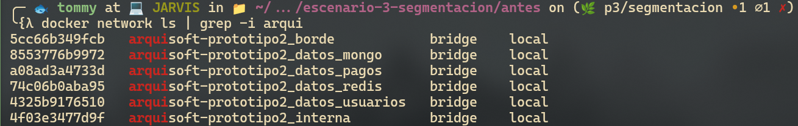

### 0b. Miembros de la red `interna`

**Los 10 servicios lógicos comparten una sola red**: de ahí que se vean todos
entre sí

```bash
docker network inspect arquisoft-prototipo2_interna \
  --format '{{range .Containers}}{{.Name}}{{"\n"}}{{end}}' | sort
```

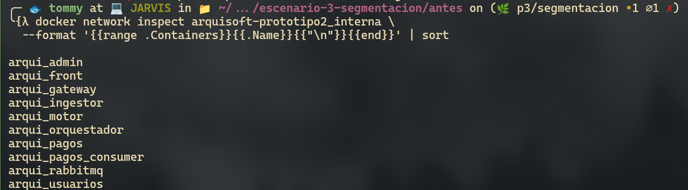

### 0c. Redes de los servicios de borde

Gateway, Front y Admin (los que reciben tráfico de afuera) están a la vez en
`borde` y en `interna`

```bash
for c in arqui_gateway arqui_front arqui_admin; do
  echo "--- $c ---"
  docker inspect "$c" --format '{{range $n,$v := .NetworkSettings.Networks}}{{$n}}{{"\n"}}{{end}}'
done
```

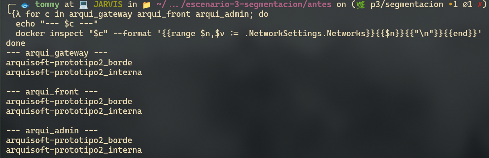

---

## A. Violaciones de alcance (movimiento lateral)

Cada prueba: un origen de borde alcanza un destino que **no le corresponde**
según la tabla "quién habla con quién" del roadmap. Son los enlaces que la
segmentación debe **cerrar**.

### A1. Gateway → consola de RabbitMQ (`:15672`)

El Gateway no debería ver RabbitMQ; aquí le sirve la consola de administración

```bash
docker exec arqui_gateway wget -qO- --timeout=5 http://rabbitmq:15672 | head -c 300
```

**Resultado:** ⚠️ responde con el HTML de *RabbitMQ Management*.

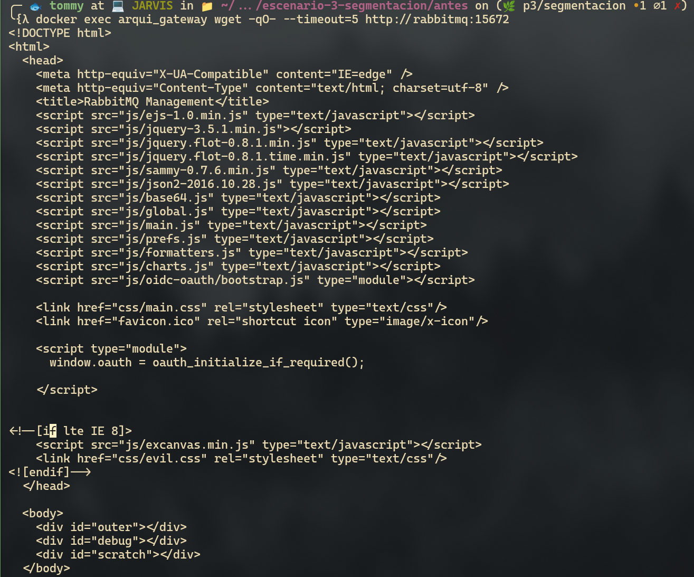

### A2. Front → Pagos (`:8000/health`)

```bash
docker exec arqui_front wget -qO- --timeout=5 http://pagos:8000/health
```

**Resultado:** ⚠️ el Front alcanza Pagos (no debería hablar con él)

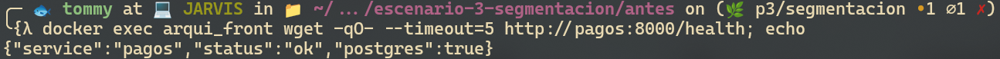

### A3. Front → Orquestador (`:8081/health`)

```bash
docker exec arqui_front wget -qO- --timeout=5 http://orquestador:8081/health
```

**Resultado:** ⚠️ el Front alcanza el Orquestador (solo debería hablar con el Gateway)

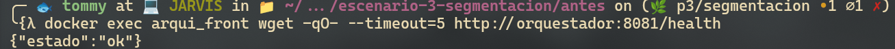

### A4. Front → Usuarios (`:8001/health`)

```bash
docker exec arqui_front wget -qO- --timeout=5 http://usuarios:8001/health
```

**Resultado:** ⚠️ el Front alcanza Usuarios

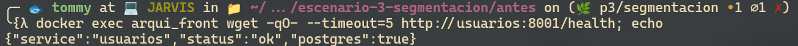

### A5. Base de datos → Internet

Ninguna red tiene `internal: true`, así que hasta una base de datos puede salir a
Internet (riesgo de exfiltración / descarga de herramientas)

```bash
docker exec arqui_pg_usuarios sh -c 'getent hosts github.com || nslookup github.com'
```

**Resultado:** ⚠️ Postgres de usuarios resuelve y sale a Internet

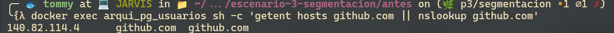

### A6. Front → `/billetera` con `X-User-Id` a mano (suplantación)

El Front no debería llegar al Orquestador. Además, escribiendo `X-User-Id` a mano
actúa como otro jugador. El contraste lo demuestra: sin el header responde
`401`; con el header responde `500` (ya no 401), es decir el Orquestador
aceptó la identidad falsificada y entró al handler (el 500 es porque ese
jugador no existe en Pagos)

> La raíz —confiar en `X-User-Id` sin firma— la cierra el escenario 4
> (autenticación entre servicios). La segmentación corta este vector cuando el
> origen deja de ver al destino, como aquí el Front. La suplantación *desde el
> Gateway* queda fuera del alcance de este escenario, porque el Gateway debe seguir
> hablando con el Orquestador.

```bash
# sin header: no autenticado
docker exec arqui_front wget -S -qO- --timeout=5 http://orquestador:8081/billetera 2>&1 | grep "HTTP/"
# con header a mano: suplantación
docker exec arqui_front wget -S -qO- --timeout=5 \
  --header="X-User-Id: 00000000-0000-0000-0000-000000000001" \
  --header="X-User-Rol: player" \
  http://orquestador:8081/billetera 2>&1 | grep "HTTP/"
```

**Resultado:** ⚠️ `401` sin header → `500` con header: la identidad falsa fue aceptada

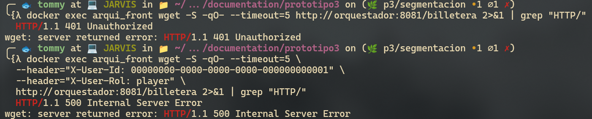

---

## B. Enlaces legítimos (deben seguir funcionando)

Estos enlaces existen por diseño según la tabla "quién habla con quién": no son
vulnerabilidades. Se documentan aquí para dejar claro que no son enlaces a
cortar, sino casos que tras segmentar deben seguir funcionando (ver sección A del
*después*)

### B1. Gateway → Motor (`:8080/health`)

El Gateway debe poder alcanzar al Motor: por ese mismo enlace de red (host `motor`,
puerto 8080) el Gateway le reenvía en producción el WebSocket de posiciones en
vivo (`/api/ws`). La prueba usa `/health` (HTTP) solo para comprobar que la
conectividad existe

```bash
docker exec arqui_gateway wget -qO- --timeout=5 http://motor:8080/health
```

**Resultado:** ✅ el Gateway alcanza al Motor (enlace legítimo)

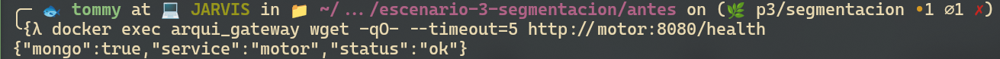

### B2. Gateway → `/internal/auth` de Usuarios

El Gateway valida cada petición protegida con `auth_request` contra Usuarios, así
que debe poder alcanzar esta ruta. El `401` sin cookie prueba que el servicio
responde (hay conectividad legítima)

```bash
docker exec arqui_gateway wget -S -qO- --timeout=5 http://usuarios:8001/internal/auth 2>&1 | head -5
```

**Resultado:** ✅ el Gateway alcanza la ruta de validación (enlace legítimo: `auth_request`)

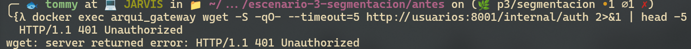

### B3. Ingestor → Internet

El Ingestor es el único servicio de backend que conserva salida a Internet tras
la segmentación (descarga el histórico de OpenF1). No es una vulnerabilidad: es el
caso que debe mantenerse para no romper la app. (Los nodos de borde —Gateway,
Front, Admin— también salen a Internet, porque sus redes publican puertos al host
y no pueden ser `internal`; eso es aceptable para componentes expuestos.)

```bash
docker exec arqui_ingestor sh -c 'getent hosts api.openf1.org || nslookup api.openf1.org'
```

**Resultado:** ✅ el Ingestor resuelve `api.openf1.org` y sale a Internet

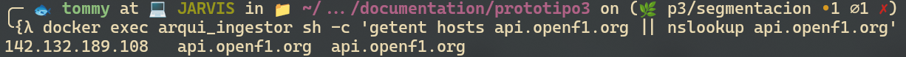

---

## Resumen

**Violaciones a cerrar** (sección A):

| # | Origen → Destino | Resultado | Debería |
|---|---|---|---|
| A1 | Gateway → RabbitMQ `:15672` | Sirve la consola HTML | No alcanzar |
| A2 | Front → Pagos `:8000` | `status: ok` | No alcanzar |
| A3 | Front → Orquestador `:8081` | `estado: ok` | No alcanzar |
| A4 | Front → Usuarios `:8001` | `status: ok` | No alcanzar |
| A5 | Postgres usuarios → `github.com` | Resuelve `140.82.114.4` | Sin salida a Internet |
| A6 | Front → `/billetera` con `X-User-Id` a mano | `401` → `500`: identidad falsa aceptada | No alcanzar |

**Enlaces legítimos a conservar** (sección B):

| # | Origen → Destino | Resultado | Debería |
|---|---|---|---|
| B1 | Gateway → Motor `:8080` | `status: ok` | Seguir (enlace del WebSocket) |
| B2 | Gateway → `/internal/auth` | `401` (responde → alcanza) | Seguir (`auth_request`) |
| B3 | Ingestor → `api.openf1.org` | Resuelve y sale a Internet | Seguir (único backend con salida) |

La fase *después* repite exactamente estas pruebas con la segmentación aplicada:
las de la sección A deben fallar (el nombre ni siquiera resuelve) y las de la
sección B deben seguir funcionando
