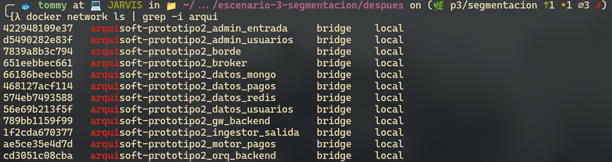
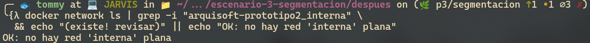
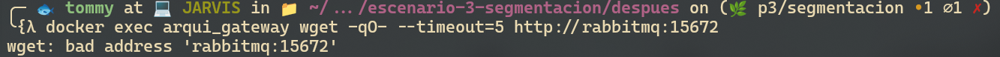
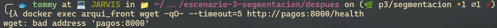
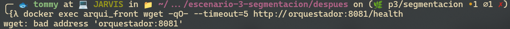
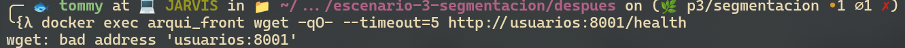
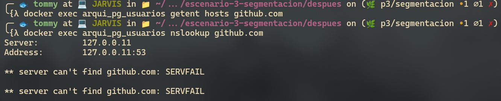
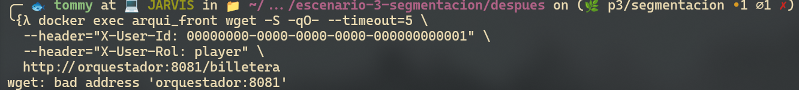
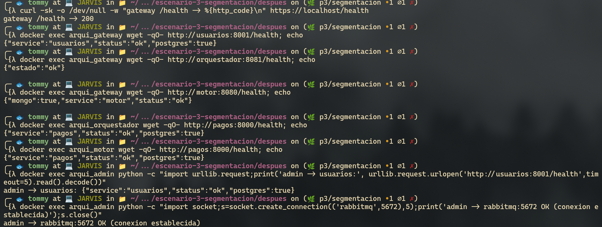
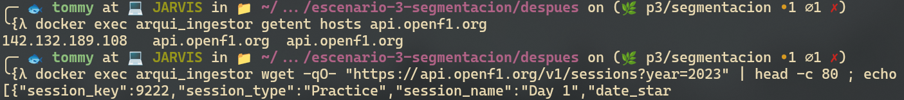

# Escenario 3 — Network Segmentation · Evidencia del *después*

**Rama:** `p3/segmentacion`

**Estado capturado:** redes segmentadas por zona de confianza (`internal: true` en las de datos y backend; el Ingestor es el único backend con salida a Internet)

Mismo plan de pruebas que el *antes*. Todos los comandos son de solo lectura

## 0. Topología después de segmentar

### 0a. Redes por zona de confianza

En vez de una sola red `interna` plana, cada red reúne solo a quienes deben
hablar entre sí

```bash
docker network ls | grep -i arqui
```



### 0b. Ya no existe la red `interna` plana

```bash
docker network ls | grep -i "arquisoft-prototipo2_interna" \
  && echo "(existe! revisar)" || echo "OK: no hay red 'interna' plana"
```



---

## A. Violaciones de alcance: ahora fallan

Las mismas violaciones del *antes* (sección A) ahora no resuelven: las redes están
aisladas, así que el nombre del destino ni siquiera existe para el origen

### A1. Gateway → consola de RabbitMQ (`:15672`)

```bash
docker exec arqui_gateway wget -qO- --timeout=5 http://rabbitmq:15672
```

**Resultado:** ✅ `wget: bad address 'rabbitmq:15672'` — el Gateway ya no ve RabbitMQ



### A2. Front → Pagos (`:8000`)

```bash
docker exec arqui_front wget -qO- --timeout=5 http://pagos:8000/health
```

**Resultado:** ✅ `wget: bad address 'pagos:8000'`



### A3. Front → Orquestador (`:8081`)

```bash
docker exec arqui_front wget -qO- --timeout=5 http://orquestador:8081/health
```

**Resultado:** ✅ `wget: bad address 'orquestador:8081'`



### A4. Front → Usuarios (`:8001`)

```bash
docker exec arqui_front wget -qO- --timeout=5 http://usuarios:8001/health
```

**Resultado:** ✅ `wget: bad address 'usuarios:8001'`



### A5. Base de datos → Internet (ahora bloqueada)

Las redes de datos tienen `internal: true`.

```bash
docker exec arqui_pg_usuarios getent hosts github.com   # exit != 0
docker exec arqui_pg_usuarios nslookup github.com        # SERVFAIL
```

**Resultado:** ✅ Postgres no resuelve (`exit=2`) ni sale: `SERVFAIL`



### A6. Front → `/billetera` con `X-User-Id` a mano (suplantación)

```bash
docker exec arqui_front wget -S -qO- --timeout=5 \
  --header="X-User-Id: 00000000-0000-0000-0000-000000000001" \
  --header="X-User-Rol: player" \
  http://orquestador:8081/billetera
```

**Resultado:** ✅ `wget: bad address 'orquestador:8081'` — el Front ni siquiera
llega al Orquestador, así que no puede suplantar

> La raíz (confiar en `X-User-Id` sin firma) la cierra el **escenario 4**. La
> segmentación corta este vector desde el Front; la suplantación *desde el Gateway*
> queda fuera del alcance de este escenario.



---

## B. Enlaces legítimos: siguen funcionando

La app completa sigue conectada: cada enlace de la tabla "quién habla con quién"
responde. Aquí se confirman, entre otros, los enlaces que en el *antes* eran las
pruebas legítimas B1 (Gateway → Motor) y B2 (Gateway → `/internal/auth`)

```bash
# Gateway desde el host (HTTPS)
curl -sk -o /dev/null -w "gateway /health -> %{http_code}\n" https://localhost/health
# Gateway -> Usuarios / Orquestador / Motor   (incluye B1: Gateway -> Motor)
docker exec arqui_gateway wget -qO- http://usuarios:8001/health; echo
docker exec arqui_gateway wget -qO- http://orquestador:8081/health; echo
docker exec arqui_gateway wget -qO- http://motor:8080/health; echo
# Gateway -> /internal/auth   (B2: auth_request; 401 = responde = alcanza)
docker exec arqui_gateway wget -S -qO- http://usuarios:8001/internal/auth 2>&1 | grep "HTTP/"
# Orquestador -> Pagos
docker exec arqui_orquestador wget -qO- http://pagos:8000/health; echo
# Motor -> Pagos
docker exec arqui_motor wget -qO- http://pagos:8000/health; echo
# Admin -> Usuarios y RabbitMQ (con salida visible)
docker exec arqui_admin python -c "import urllib.request;print('admin -> usuarios:', urllib.request.urlopen('http://usuarios:8001/health',timeout=5).read().decode())"
docker exec arqui_admin python -c "import socket;s=socket.create_connection(('rabbitmq',5672),5);print('admin -> rabbitmq:5672 OK (conexion establecida)');s.close()"
```

**Resultado:** ✅ Gateway `200`; todos los enlaces legítimos responden (incluidos
Gateway → Motor y Gateway → `/internal/auth`)



### B3. Ingestor → Internet (sigue funcionando)

Único servicio de backen con salida a Internet (red `ingestor_salida`, no
`internal`). Las bases de datos y los demás servicios internos no salen; los nodos
de borde (Gateway, Front, Admin) sí, porque publican puertos al host.

```bash
docker exec arqui_ingestor getent hosts api.openf1.org
docker exec arqui_ingestor wget -qO- "https://api.openf1.org/v1/sessions?year=2023" | head -c 80
```

**Resultado:** ✅ resuelve y descarga datos reales de OpenF1



---

## Resumen (antes → después)

**Violaciones cerradas** (sección A):

| # | Prueba | Antes | Después | Esperado |
|---|---|---|---|---|
| A1 | Gateway → RabbitMQ `:15672` | Sirve consola | `bad address` | Cerrar ✅ |
| A2 | Front → Pagos | `status: ok` | `bad address` | Cerrar ✅ |
| A3 | Front → Orquestador | `estado: ok` | `bad address` | Cerrar ✅ |
| A4 | Front → Usuarios | `status: ok` | `bad address` | Cerrar ✅ |
| A5 | Postgres → Internet | Resuelve `github.com` | `SERVFAIL` | Cerrar ✅ |
| A6 | Front → suplantación `/billetera` | `401`→`500` (aceptada) | `bad address` | Cerrar ✅ |

**Enlaces legítimos conservados** (sección B):

| # | Prueba | Antes | Después | Esperado |
|---|---|---|---|---|
| B1 | Gateway → Motor (enlace del WebSocket) | `status: ok` | `status: ok` | Seguir ✅ |
| B2 | Gateway → `/internal/auth` | `401` (responde) | `401` (responde) | Seguir ✅ |
| B3 | Ingestor → Internet | descarga OpenF1 | descarga OpenF1 | Seguir ✅ |
| — | App completa (login/compra/apuesta/WS) | funciona | funciona | Seguir ✅ |

La segmentación cerró las 6 violaciones (el nombre ya ni resuelve) y conservó
todos los enlaces legítimos. Las pruebas B1 y B2 siguen respondiendo porque el
Gateway sí debe hablar con Motor y con Usuarios según la tabla de confianza:
no eran enlaces a cortar