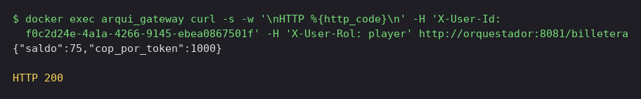
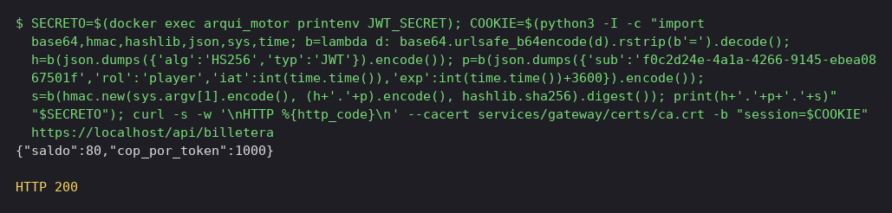
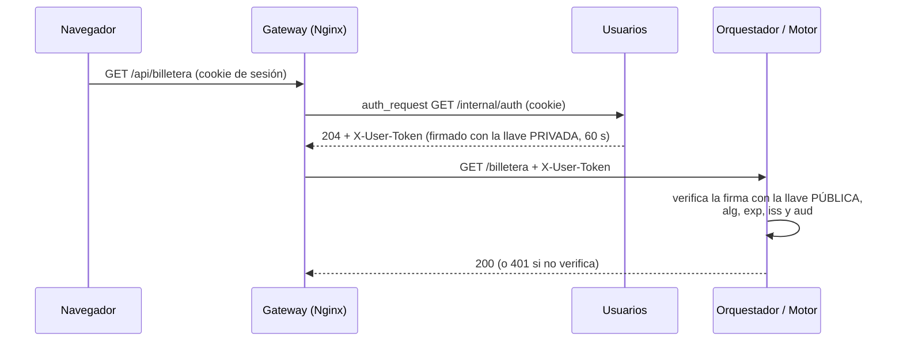
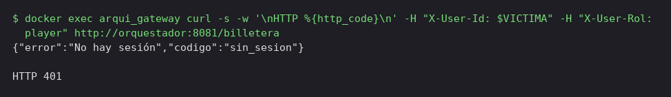
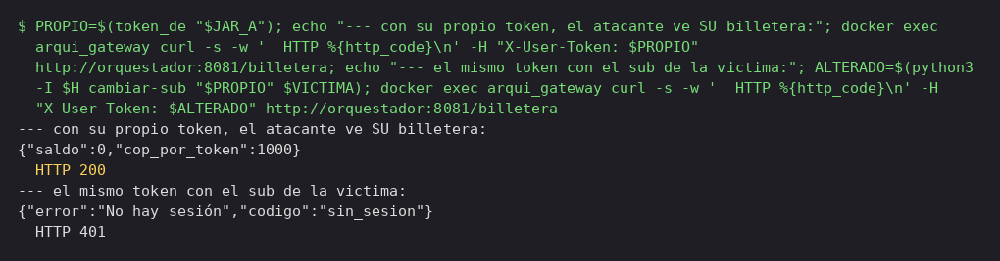
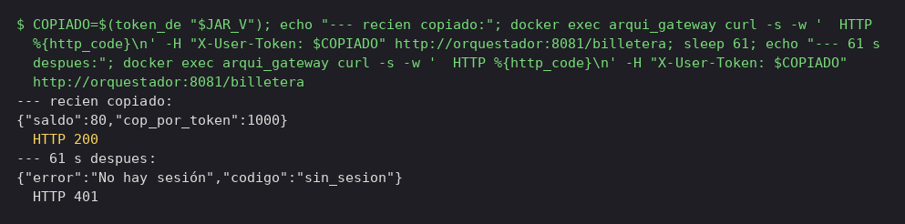
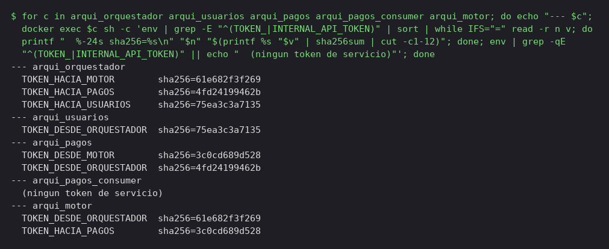
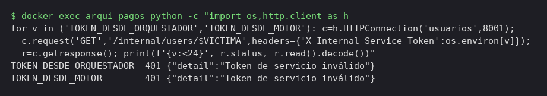

# Escenario 4 — Autenticación entre servicios (T3-05)

**Dueño:** William
**Patrón:** Autenticación entre servicios (*Authenticator*): identidad firmada del jugador y un token por cada par de servicios
**Tácticas (Bass, §11.2):** *Authenticate actors* y *Authorize actors* (categoría **resistir**)
**Atributos de calidad:** Confidencialidad, integridad
**Rama de trabajo:** `feature/william-auth-entre-servicios`

> Estructura del roadmap:
> 1. El problema, justificado sobre la vista C&C y la de despliegue.
> 2. Evidencia de la vulnerabilidad (antes).
> 3. Táctica, patrón e implementación.
> 4. La misma prueba con la contramedida funcionando (después).
> 5. Qué cambia en las vistas C&C y de despliegue.
>
> Al final: alcance, riesgos y notas para el equipo.

## Escenario de atributo de calidad

| Parte | Valor |
|---|---|
| **Fuente** | Un componente interno comprometido (Gateway, Pagos, Motor, Usuarios) o quien saque un secreto de su contenedor |
| **Estímulo** | Intenta actuar como otro jugador (escribe `X-User-Id` a mano, altera o fabrica un token de identidad, fabrica una cookie con un secreto robado) o llama a las rutas `/internal/*` de un servicio que no le corresponde, con los tokens que encuentre en su contenedor |
| **Artefacto** | Orquestador y Motor (conectores Gateway → Orquestador y Gateway → Motor), Usuarios como emisor de la identidad, y las rutas `/internal/*` de Usuarios, Pagos y Motor |
| **Entorno** | Operación normal, con los escenarios 1, 2, 3 y 5 ya integrados |
| **Respuesta** | El servicio verifica la firma de la identidad con la llave pública de Usuarios y rechaza todo lo que Usuarios no firmó; cada ruta interna acepta solo el token de los servicios que deben llamarla |
| **Medida** | 100 % de los intentos de suplantación reciben 401 (A3–A8, B2, C1–C4 y C6 de la evidencia); 100 % de las llamadas internas con el token de un servicio que no debe hacerlas reciben 401 (D2–D6); un token legítimo copiado deja de servir en ≤ 60 s; los flujos de login, compra, apuesta, WebSocket, Admin y registro siguen funcionando (R1–R8) |

---

## 1. El problema (antes)

### Sobre la vista C&C

- **Los servicios internos no verificaban quién los llamaba.** El Orquestador
  (`services/orquestador/internal/sesion/sesion.go`) y el WebSocket del Motor
  (`services/motor/internal/auth/middleware.go`) identificaban al jugador con la
  cabecera `X-User-Id`, sin ninguna firma. Era seguro *solo* si el único que
  podía escribirla era el Gateway: el conector Gateway → Orquestador se
  **suponía** de confianza, pero nada lo comprobaba.
- **El Motor tenía la llave de las sesiones.** La cookie de sesión es un JWT
  HS256 firmado con `JWT_SECRET`, y el Motor lo tenía para validar cookies
  (herencia del prototipo 1, cuando el WebSocket no pasaba por el Gateway). Con
  HS256 **quien puede verificar también puede firmar**: el Motor podía fabricar
  la sesión de cualquier usuario, y Usuarios la aceptaría.
- **Un solo token para todas las rutas internas.** Las rutas `/internal/*` de
  Usuarios, Pagos y Motor pedían el mismo `INTERNAL_API_TOKEN`, y lo tenían los
  cinco contenedores (incluido el consumidor de Pagos, que no hace llamadas
  HTTP). Ningún servicio sabía quién lo llamaba: el Motor y Pagos podían leer
  los datos personales de cualquier usuario en Usuarios, aunque en la vista C&C
  no tienen ese conector.

### Sobre la vista de despliegue

- La segmentación del escenario 3 redujo quién llega al Orquestador, pero
  siguen siendo cuatro contenedores: Gateway, Usuarios y Motor (`gw_backend`) y
  Pagos (`orq_backend`). Y **el Gateway siempre va a llegar**: es el que recibe
  tráfico de afuera, el nodo con más riesgo de caer.
- `JWT_SECRET` estaba en las variables de entorno de dos contenedores (Usuarios
  y Motor): bastaba sacarlo de uno.

### Riesgo

Quien comprometa cualquiera de esos contenedores puede **suplantar a cualquier
jugador**: ver su saldo y sus datos, comprar, inscribirse o apostar a su nombre, y
recibir sus mensajes del WebSocket. Con el secreto del Motor, lo hace incluso
**desde afuera**, por el Gateway público. Y con el token compartido, puede usar
las rutas internas de cualquier otro servicio. Se comprometen la confidencialidad
(datos y saldos de otros) y la integridad (operaciones a nombre de otro).

---

## 2. Evidencia de la vulnerabilidad (antes)

Detalle, comandos y capturas: [`antes/evidencia-antes.md`](antes/evidencia-antes.md).
Capturada en la rama, sobre el mismo commit de `main` (`d8e74a9`).

| # | Ataque | Resultado |
|---|---|---|
| A3–A5 | `X-User-Id` a mano desde el Gateway → Orquestador | 200 saldo, 200 datos personales, 201 compra a nombre de la víctima |
| A6 | Lo mismo desde Pagos | 200 |
| A8 | `X-User-Id` a mano → WebSocket del Motor | 101: conectado como la víctima |
| B2 | Cookie fabricada con el `JWT_SECRET` del Motor, por el Gateway **público** | 200 |
| C1 | El mismo `INTERNAL_API_TOKEN` en cinco contenedores (uno no lo usa) | — |
| C2–C3 | El Motor y Pagos leen los datos personales de la víctima en Usuarios | 200 |

---

## 3. Táctica, patrón e implementación

**Authenticate actors:** el Orquestador y el Motor ya no confían en el canal;
verifican que la afirmación "esta petición es del jugador X" la emitió Usuarios,
el único actor que comprobó la cookie. **Authorize actors:** el rol viaja dentro
de la misma identidad firmada, así que la regla "solo jugadores" (403 al admin
en el Orquestador, `ExigirRol` en el Motor) se decide sobre un dato que no se
puede alterar.

### El token de identidad

| | Cookie de sesión (ya existía) | Identidad firmada (nueva) |
|---|---|---|
| Para qué | Recordar que el usuario inició sesión | Decirle a Orquestador y Motor quién hace esta petición |
| Dura | 2 horas | 60 segundos |
| Algoritmo | HS256, con `JWT_SECRET` | EdDSA (Ed25519), con llave privada y pública |
| Quién firma | Usuarios, en el login | Usuarios, en cada `GET /internal/auth` |
| Quién verifica | Solo Usuarios | Orquestador y Motor, con la llave pública |
| Dónde viaja | Navegador ↔ Gateway | Solo dentro de la red interna (`X-User-Token`) |

Claims: `sub` (id), `rol` (`player`/`admin`), `iss` = `usuarios`, `aud` =
`polebet`, `iat`, `exp`. Los verificadores fijan el algoritmo (rechazan `none` y
HS256), exigen `exp` y comprueban emisor y audiencia.

### Tokens de servicio: uno por par llamador → destino

`INTERNAL_API_TOKEN` desaparece. En su lugar hay un token por cada conector
interno de la vista C&C, y cada servicio acepta solo los de quienes deben
llamarlo (*Authorize actors*). Sigue viajando en la misma cabecera
`X-Internal-Service-Token`.

| Token (en el `.env`) | Lo manda | Lo acepta | Rutas |
|---|---|---|---|
| `TOKEN_ORQUESTADOR_USUARIOS` | Orquestador | Usuarios | `/internal/users` |
| `TOKEN_ORQUESTADOR_PAGOS` | Orquestador | Pagos | `/internal/*` de Pagos |
| `TOKEN_ORQUESTADOR_MOTOR` | Orquestador | Motor | `/internal/apuestas`, `/internal/posiciones`, `/internal/dinamica-actual` |
| `TOKEN_MOTOR_PAGOS` | Motor | Pagos | `/internal/*` de Pagos |

Cada token lo tienen solo los dos extremos de su par. Por eso lo que se saque
de un contenedor solo sirve contra ese mismo contenedor o contra quien ya
llamaba legítimamente:

| Contenedor | Tiene | Puede llamar a |
|---|---|---|
| Orquestador | sus 3 tokens de salida | Usuarios, Pagos, Motor (como antes) |
| Motor | el que acepta del Orquestador y el suyo hacia Pagos | solo Pagos |
| Pagos | los que acepta del Orquestador y del Motor | nadie (no hay ruta que acepte esos tokens fuera de Pagos) |
| Usuarios | el que acepta del Orquestador | nadie |
| Consumidor de Pagos | ninguno | nadie |

### Archivos cambiados y por qué

| Archivo | Cambio |
|---|---|
| `scripts/generar-llaves-identidad.sh` | Nuevo. Genera el par Ed25519 en `services/usuarios/llaves/` (en `.gitignore`), con `openssl` local o la imagen `alpine/openssl` |
| `services/usuarios/app/core/identidad.py` | Nuevo. Lee la llave privada al arrancar y firma la identidad |
| `services/usuarios/app/routers/internal.py` | `GET /internal/auth` devuelve además `X-User-Token` |
| `services/usuarios/app/config.py`, `main.py`, `requirements.txt` | `IDENTIDAD_LLAVE_PRIVADA`, `IDENTIDAD_TTL_SEGUNDOS` (60); si falta la llave, no arranca; `cryptography` para EdDSA |
| `services/gateway/rutas.conf`, `nginx.conf`, `admin.conf` | `/api/` y `/api/ws` reenvían solo `X-User-Token` (copiado de la respuesta de `auth_request`) y dejan vacíos `X-User-Id`/`X-User-Rol`; todas las demás rutas borran el `X-User-Token` que mande el cliente |
| `services/orquestador/internal/sesion/sesion.go` | `ExigirJugador` verifica la firma Ed25519 en lugar de leer `X-User-Id`; sin llave configurada rechaza todo (falla cerrado) |
| `services/orquestador/internal/sesion/sesiontest/` | Nuevo. Firma identidades de prueba para los tests de los módulos |
| `services/orquestador/main.go`, `internal/config`, `go.mod`, `go.sum`, `Dockerfile` | `IDENTIDAD_LLAVE_PUBLICA`; `golang-jwt/jwt/v5 v5.3.1` (la misma versión del Motor) |
| `services/motor/internal/auth/` | `ValidadorEd25519` reemplaza a `ValidadorHS256` detrás de la misma interfaz `ValidarToken`; `Identificar` (WebSocket) y `ExigirSesion` leen `X-User-Token`; ya no se acepta `X-User-Id` ni la cookie |
| `services/motor/main.go`, `internal/config` | `IDENTIDAD_LLAVE_PUBLICA` en lugar de `JWT_SECRET` |
| `docker-compose.yml` | La privada entra solo a Usuarios como *secret* de Compose (`/run/secrets`); la pública, como archivo de solo lectura, al Orquestador y al Motor; el Motor pierde `JWT_SECRET` |
| Tests | Usuarios (pytest), Orquestador y Motor (`go test`): firma otra llave, cuerpo cambiado, `none`, HS256, vencido, sin `exp`, otro `iss`/`aud`, `X-User-Id` solo |
| **Tokens de servicio** | |
| `scripts/generar-tokens-servicio.sh` | Nuevo. Escribe en el `.env` los cuatro tokens con valores aleatorios de 64 caracteres (solo los que falten, o todos con `--forzar`) |
| `.env.example`, `docker-compose.yml` | `INTERNAL_API_TOKEN` se reemplaza por los cuatro tokens; cada contenedor recibe solo los suyos con nombres que dicen la dirección (`TOKEN_HACIA_PAGOS`, `TOKEN_DESDE_ORQUESTADOR`…); el consumidor de Pagos no recibe ninguno |
| `services/orquestador/internal/config`, `main.go` | `TOKEN_HACIA_USUARIOS`, `TOKEN_HACIA_PAGOS`, `TOKEN_HACIA_MOTOR`: un cliente interno con su propio token por destino |
| `services/motor/internal/config`, `main.go` | `TOKEN_DESDE_ORQUESTADOR` para sus rutas `/internal/*` y `TOKEN_HACIA_PAGOS` para los 8 clientes de Pagos |
| `services/usuarios/app/config.py`, `core/internal_auth.py` | Acepta solo `TOKEN_DESDE_ORQUESTADOR` |
| `services/pagos/app/core/config.py`, `core/internal_auth.py`, `main.py` | Acepta `TOKEN_DESDE_ORQUESTADOR` y `TOKEN_DESDE_MOTOR` (`servicio_que_llama` dice cuál de los dos); la app HTTP no arranca sin ellos, el consumidor no los necesita |
| Tests | Usuarios y Pagos rechazan el token de otro par; Orquestador, Motor y Pagos no arrancan si dos de sus tokens son iguales |

### Decisiones

- **Asimétrico (Ed25519) y no un secreto compartido.** Con un secreto
  compartido, cada servicio que verifica podría también firmar, que es justo el
  problema del `JWT_SECRET` del Motor. Con la llave pública solo se verifica:
  si alguien la saca de un contenedor, no gana nada.
- **Ed25519 y no RS256.** Igual de seguro para este uso, pero firma mucho más
  rápido, y Usuarios firma un token en **cada** petición protegida (lo que suma
  en el análisis de desempeño, T3-08). Llaves de 32 bytes.
- **60 segundos de vida.** Suficiente para que la petición llegue a su destino;
  muy poco para reusar un token copiado. El WebSocket verifica solo al abrir la
  conexión, así que la vida corta no lo corta.
- **`X-User-Id` y `X-User-Rol` siguen en la respuesta de `/internal/auth`**
  porque Admin llama esa ruta directo y los lee (`services/admin/app/sesion.py`).
  El Gateway ya no se los reenvía a nadie.
- **Usuarios sigue leyendo el rol de la base** en cada `/internal/auth`: la
  identidad firmada lleva el rol actual, no el del login.
- **Un token por par, no uno por servicio.** Con un token por servicio, Pagos
  tendría que guardar el token del Orquestador para reconocerlo, y con él podría
  llamar a Usuarios y al Motor *como* el Orquestador. Por pares, el token que
  Pagos guarda solo lo acepta Pagos.
- **Tokens repetidos no arrancan.** Si alguien copia el mismo valor en dos
  tokens de un servicio, se vuelve al token compartido sin que nadie lo note. El
  Orquestador, el Motor y Pagos revisan al arrancar que sus tokens sean
  distintos (prueba D8).
- **Secretos simétricos y no firmas.** Para llamadas servicio a servicio en una
  red interna, un token aleatorio de 256 bits comparado en tiempo constante es
  suficiente y no agrega costo por petición. La alternativa fuerte (mTLS con
  certificado por servicio) queda anotada en los riesgos.

---

## 4. La misma prueba, con la contramedida funcionando (después)

Detalle, comandos y capturas: [`despues/evidencia-despues.md`](despues/evidencia-despues.md).

| # | Ataque | Antes | Después |
|---|---|---|---|
| A3–A5 | `X-User-Id` a mano → Orquestador | 200 / 200 / 201 | **401** |
| A6 | Lo mismo desde Pagos | 200 | **401** |
| A8 | `X-User-Id` a mano → WebSocket del Motor | 101 | **401** |
| B2 | Cookie fabricada con el secreto del Motor | 200 | **401** (el Motor no tiene secreto) |
| C1 | Token propio con el `sub` de la víctima | — | **401** |
| C2 | Token firmado con otra llave Ed25519 | — | **401** |
| C3 | `alg: none` | — | **401** |
| C4 | HS256 firmado con el `JWT_SECRET` real | — | **401** |
| C5 | Token real reusado a los 61 s | — | **401** (200 dentro del minuto) |
| C6 | Token alterado → WebSocket | — | **401** |
| D1 | Tokens de servicio por contenedor | el mismo en 5 | uno por par; el consumidor, ninguno |
| D2 | Motor → Usuarios con sus tokens | 200 | **401** |
| D3 | Pagos → Usuarios con sus tokens | 200 | **401** |
| D4 | Pagos → Motor con sus tokens | 200 | **401** |
| D5 | Usuarios → Pagos con su token | 200 | **401** |
| D6 | Orquestador → Usuarios con el token de otro destino | 200 | **401** (con el suyo, 200) |
| D7 | Llamadas legítimas (Motor → Pagos, Orquestador → Pagos y Motor) | 200 | 200 / 404 de negocio |
| D8 | Orquestador con dos tokens iguales | arranca | **no arranca** |

D4–D8 no se capturaron en el *antes*: con un solo token, cualquier servicio
mandaba el mismo valor que aceptaban todos, así que esas llamadas pasaban.

Regresión por el Gateway (repetida con los tokens por par): login 200,
billetera 200, compra 201, página 200, apuesta llega a la regla de negocio (409
`mercado_cerrado`, no 401), WebSocket 101 identificado con el token firmado,
Admin 200, registro 201.

Pruebas automáticas: Orquestador y Motor `go vet` y `go test ./...` en verde;
Pagos 164 de 164; Usuarios 38 de 39 (la que falla es previa a este escenario,
ver notas).

---

## 5. Qué cambia en las vistas

### Vista C&C

- **Usuarios** pasa a ser también el **emisor de identidad** del sistema: su
  puerto `GET /internal/auth` entrega una identidad firmada además de aprobar la
  sesión.
- Los conectores **Gateway → Orquestador (REST)** y **Gateway → Motor
  (WebSocket)** llevan ahora `X-User-Token` (identidad firmada, EdDSA) en lugar
  de `X-User-Id`/`X-User-Rol` en texto. El receptor la verifica: el conector deja
  de ser "de confianza por posición".
- El **Motor ya no valida cookies de sesión** ni comparte `JWT_SECRET` con
  Usuarios: la única dependencia de autenticación del Motor y del Orquestador es
  la llave pública de Usuarios.
- Los conectores internos **Orquestador → Usuarios, Orquestador → Pagos,
  Orquestador → Motor y Motor → Pagos** llevan cada uno su propia credencial.
  Los puertos `/internal/*` dejan de aceptar "cualquier servicio interno" y
  aceptan solo a los llamadores de esos conectores: la vista C&C ahora coincide
  con lo que el sistema permite.

### Vista de despliegue

- Nuevo artefacto: el par de llaves Ed25519, generado con
  `scripts/generar-llaves-identidad.sh` (no se versiona).
- La **llave privada** se despliega solo en el contenedor de Usuarios, como
  *secret* de Compose en `/run/secrets/identidad_llave_privada`.
- La **llave pública** se monta de solo lectura en el Orquestador y el Motor
  (`/etc/polebet/identidad.pub`).
- `JWT_SECRET` queda solo en Usuarios.
- `INTERNAL_API_TOKEN` desaparece; los cuatro tokens por par salen del `.env`
  (`scripts/generar-tokens-servicio.sh`) y cada contenedor recibe solo los
  suyos. El consumidor de Pagos ya no recibe ninguno.
- Sin cambios de redes ni de puertos.

---

## Alcance, riesgos y notas para el equipo

- **Alcance: las dos partes del roadmap.** La identidad firmada cierra la
  **suplantación de jugadores**; los tokens por par cierran las **llamadas
  internas de servicios que no deben hacerlas**.
- **Los tokens de servicio son secretos simétricos en variables de entorno.**
  Quien saque el `.env` del host los tiene todos, y quien comprometa el
  Orquestador tiene sus tres tokens de salida (pero esas llamadas ya las podía
  hacer). Tampoco autorizan por ruta: el Motor puede llamar a cualquier
  `/internal/*` de Pagos, no solo a las que usa. Lo siguiente sería mTLS con un
  certificado por servicio.
- **Riesgo residual del Gateway.** El TLS termina en el Gateway, así que un
  Gateway comprometido ve las cookies de quienes pasan por él y puede pedir su
  identidad a Usuarios. La contramedida no lo vuelve inofensivo, pero sí acota el
  daño: ya no puede actuar como **cualquier** jugador a partir de un id, solo
  como los que estén usando el sistema en ese momento. Lo que sí queda cerrado
  del todo es que Pagos, Usuarios o el Motor suplanten jugadores ante el
  Orquestador.
- **Reuso dentro del minuto.** Un token copiado en tránsito sirve hasta que
  vence (C5). Se acepta por la vida corta; cerrarlo del todo exigiría atar el
  token a la petición o al canal (mTLS), fuera del alcance.
- **Cada quien debe generar las llaves** antes de levantar el sistema:
  `scripts/generar-llaves-identidad.sh`. Sin ellas, Compose falla al montar el
  secret o el volumen (mensaje claro), y Usuarios, el Orquestador y el Motor no
  arrancan.
- **Cada quien debe agregar los tokens a su `.env`**: copiar las cuatro líneas
  `TOKEN_*` de `.env.example` o correr `scripts/generar-tokens-servicio.sh`.
  Sin ellos, el Orquestador, el Motor, Usuarios y Pagos no arrancan y el log dice
  qué variable falta. `INTERNAL_API_TOKEN` se puede borrar del `.env`.
- **Volúmenes viejos de `postgres-usuarios`.** Si la base se creó antes del
  escenario 5, Usuarios no arranca (`column users.failed_login_attempts does not
  exist`); ver la preparación en [`antes/evidencia-antes.md`](antes/evidencia-antes.md).
- **Test previo que falla:** `services/usuarios/tests/test_users.py::test_health_y_tabla_users_sin_saldo`
  compara las columnas exactas de `users` y no incluye las dos que agregó el
  escenario 5. No es de este escenario.
- **Desempeño (T3-08):** Usuarios ahora firma un token por petición protegida y
  el Orquestador/Motor verifican una firma. Conviene incluirlo en la medición
  final para cuantificar el costo.
