# Escenario 4 — Autenticación entre servicios · Evidencia del *después*

**Rama:** `feature/william-auth-entre-servicios`

**Estado capturado:** Usuarios firma la identidad con Ed25519 (`X-User-Token`, 60 s);
el Orquestador y el Motor la verifican con la llave pública y ya no leen `X-User-Id`;
el Motor ya no tiene `JWT_SECRET`. `INTERNAL_API_TOKEN` se reemplazó por un token
de servicio por cada par llamador → destino.

Las salidas en texto están en [`salidas/`](salidas/), el script que las produce es
[`capturar-despues.sh`](capturar-despues.sh) y los tokens del atacante los arma
[`herramientas_jwt.py`](herramientas_jwt.py) (biblioteca estándar de Python). Los
comandos usan estas variables y funciones, definidas en el script:

| Nombre | Qué es |
|---|---|
| `$VICTIMA` | id de la víctima (`f0c2d24e-4a1a-4266-9145-ebea0867501f`) |
| `$CA` | `services/gateway/certs/ca.crt` |
| `$JAR_V`, `$JAR_A` | cookies de sesión de la víctima y del atacante (login normal) |
| `token_de JAR` | pide a Usuarios, desde el Gateway, la identidad firmada de esa sesión (lo mismo que hace `auth_request`): es un token real que viaja por la red interna |
| `$H` | `herramientas_jwt.py` |

Preparación previa a la captura:

```bash
scripts/generar-llaves-identidad.sh
scripts/generar-tokens-servicio.sh
docker compose up -d --build usuarios orquestador motor pagos pagos-consumer gateway
bash documentation/prototipo3/escenario-4-auth-servicios/despues/capturar-despues.sh \
  documentation/prototipo3/escenario-4-auth-servicios/despues/salidas
```

---

## A. Los mismos ataques del *antes*

### A1–A2. Controles: siguen igual (401)

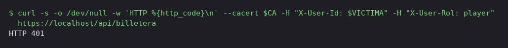
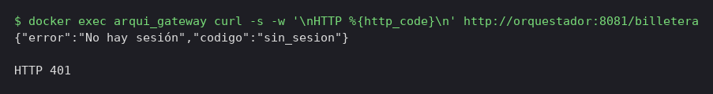

### A3–A5. `X-User-Id` a mano desde el Gateway: 401

Antes: 200 con el saldo, 200 con los datos personales y 201 con una compra a
nombre de la víctima. Ahora el Orquestador ni siquiera mira `X-User-Id`: sin
`X-User-Token` firmado no hay sesión.

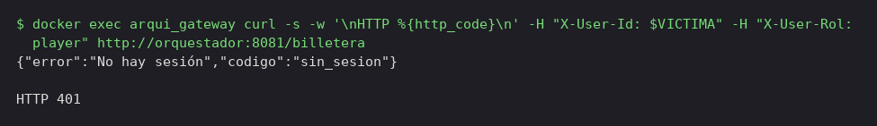
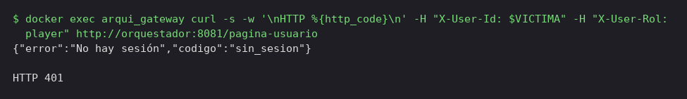
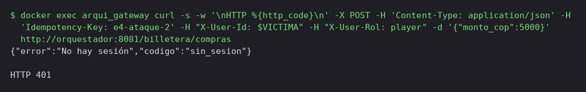

### A6. Desde Pagos: 401

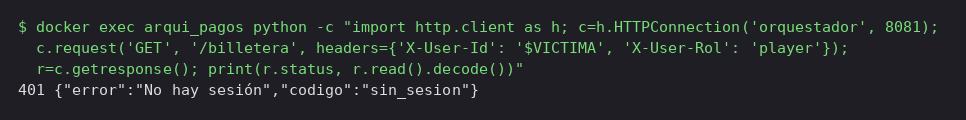

### A7–A8. WebSocket del Motor con `X-User-Id` a mano: 401

Antes: `101 Switching Protocols`, conectado como la víctima.

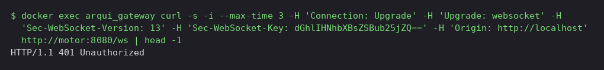
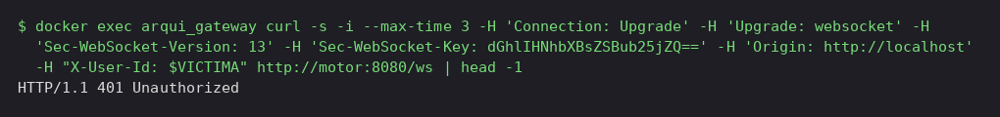

---

## B. El Motor ya no tiene la llave de las sesiones

### B1. `JWT_SECRET` solo está en Usuarios

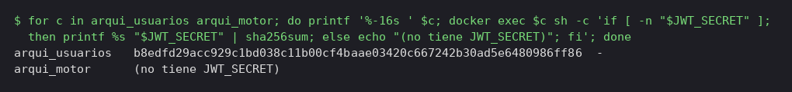

### B2. La cookie fabricada con lo que hay en el Motor: 401

El mismo comando del *antes*. Del Motor ya no sale ningún secreto (`''`), y una
cookie firmada con eso no la acepta Usuarios. Antes este ataque entraba por el
Gateway **público** como cualquier jugador.

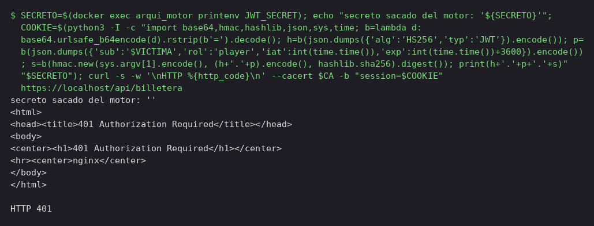

### B3. Dónde está cada llave

La privada (`/run/secrets`, un *secret* de Compose) solo está en Usuarios. El
Orquestador y el Motor tienen solo la pública, que sirve para verificar y no
para firmar. El Gateway y Pagos no tienen ninguna.

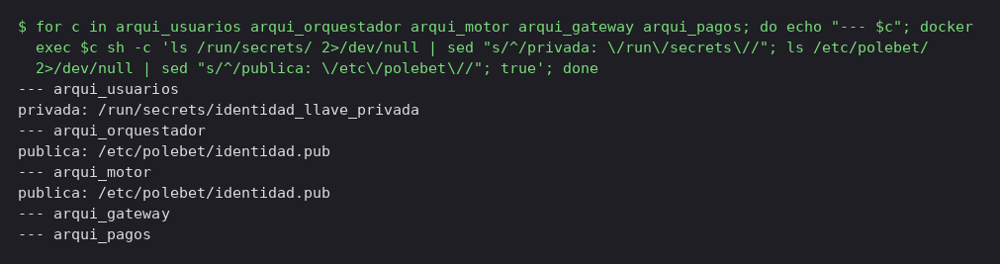

---

## C. Ataques contra la firma

Estas pruebas no tienen *antes*: el token firmado no existía.

### C1. El atacante cambia el `sub` de su propio token

Con su token real ve su billetera (200). Si cambia el `sub` por el de la víctima
y deja la firma original, la firma deja de coincidir: 401.

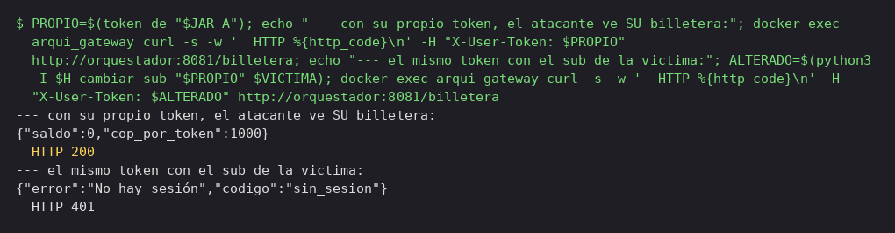

### C2. Token firmado con una llave Ed25519 del atacante

El atacante genera su propio par con `openssl` y firma un token bien formado para
la víctima (la firma es válida para *su* llave, ver nota). No es la llave de
Usuarios: 401.

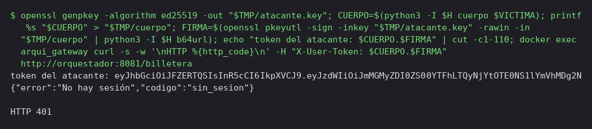

> Comprobación aparte de que el token del atacante está bien formado: la firma
> mide 64 bytes y `openssl pkeyutl -verify` con la pública del atacante responde
> `Signature Verified Successfully`. El rechazo se debe solo a la llave.

### C3. Token sin firma (`alg: none`): 401

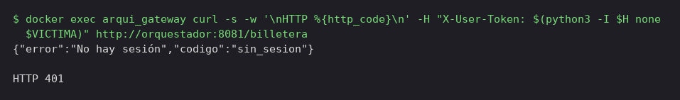

### C4. Token HS256 firmado con el `JWT_SECRET` real: 401

Aunque alguien robe el secreto de la cookie (de Usuarios), no puede fabricar
identidades: el Orquestador solo acepta EdDSA (*algorithm confusion*).

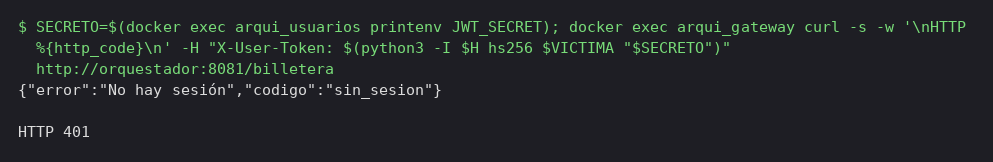

### C5. Un token real copiado sirve menos de un minuto

Recién copiado: 200. A los 61 s: 401. Es el riesgo que queda (ver README): quien
copie un token en tránsito lo puede usar durante ese minuto, solo para ese
usuario.

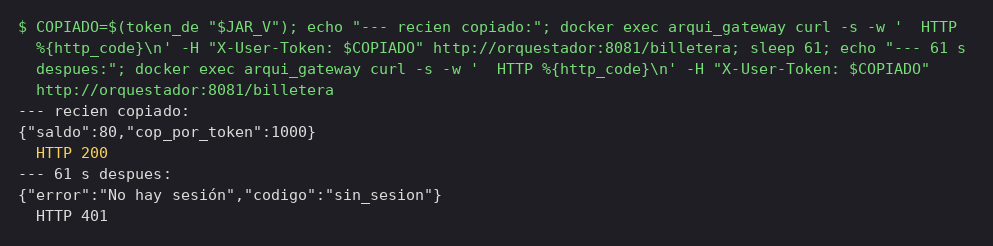

### C6. WebSocket del Motor con un token alterado: 401

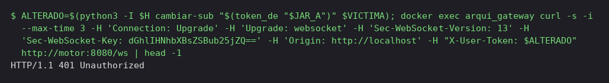

---

## D. Tokens de servicio: uno por par llamador → destino

Contraparte de la sección C del *antes*, donde los cinco contenedores tenían el
mismo `INTERNAL_API_TOKEN` y el Motor y Pagos leían datos de Usuarios. En cada
prueba el "atacante" usa **todos** los tokens que hay en el contenedor que
comprometió. Los tokens se muestran solo como el inicio de su sha256.

### D1. Qué token tiene cada contenedor

Cada token aparece exactamente en dos contenedores, los extremos de su par (el
mismo hash a los dos lados). El consumidor de Pagos ya no tiene ninguno y
`INTERNAL_API_TOKEN` ya no existe.

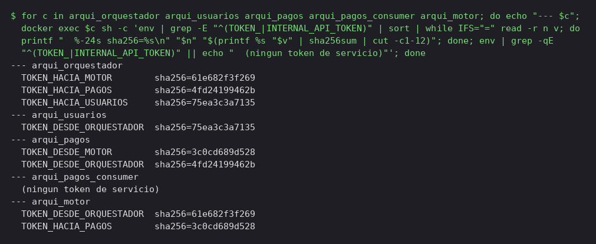

### D2. El Motor ya no lee datos de Usuarios: 401

Antes (C2): 200 con los datos de la víctima. Ninguno de los dos tokens del
Motor lo acepta Usuarios.

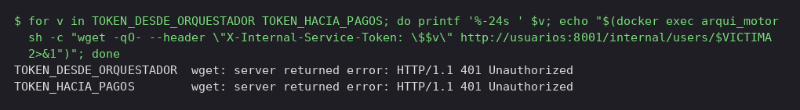

### D3. Pagos tampoco: 401

Antes (C3): 200.

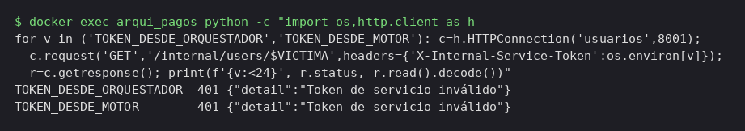

### D4. Pagos no puede llamar al Motor: 401

Pagos guarda los tokens con los que lo llaman el Orquestador y el Motor, pero
ninguno de los dos es el que el Motor acepta (`TOKEN_ORQUESTADOR_MOTOR`).

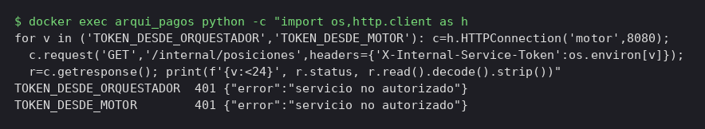

### D5. Usuarios no puede llamar a Pagos: 401

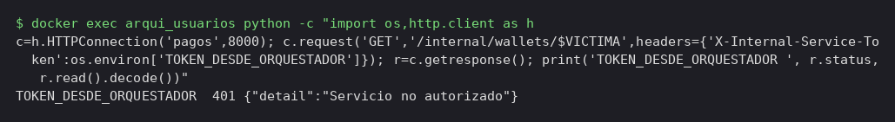

### D6. Un token sirve solo para su destino

El Orquestador sí llama a Usuarios, pero solo con el token de ese par. Con el de
Pagos o el del Motor, 401.

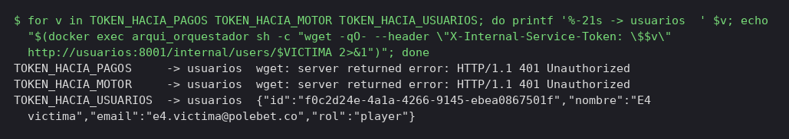

### D7. Las llamadas legítimas siguen pasando

Motor → Pagos y Orquestador → Pagos: 200 con la billetera. Orquestador → Motor:
con el token de Pagos, 401; con el suyo, 404 (pasa la autenticación y llega a la
regla: no hay un mercado dinámico abierto).

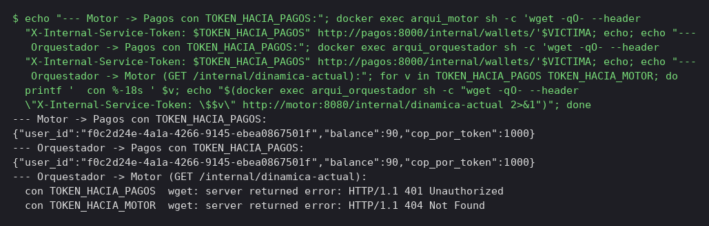

### D8. Dos tokens iguales: el servicio no arranca

Si alguien copia el mismo valor en dos tokens, se vuelve al token compartido sin
que nadie lo note. El Orquestador lo detecta al arrancar (el Motor y Pagos hacen
lo mismo con los suyos).

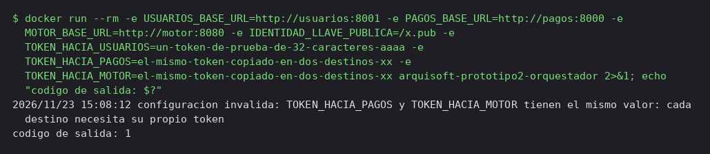

---

## R. Regresión: la app sigue funcionando por el Gateway

Capturada otra vez después de cambiar a los tokens por par: los flujos usan los
cuatro conectores internos (Orquestador → Usuarios, Pagos y Motor; Motor → Pagos).

| # | Flujo | Resultado |
|---|---|---|
| R1 | Login | 200 |
| R2 | Billetera | 200 |
| R3 | Compra de tokens | 201 (saldo 80 → 90) |
| R4 | Página del usuario (SSR) | 200 |
| R5 | Apuesta | 409 `mercado_cerrado`: pasó la autenticación y llegó a la regla de negocio (no había una carrera en curso; ver nota) |
| R6 | WebSocket | 101; el Motor registra la conexión con el id de la víctima, sacado del token firmado |
| R7 | Admin por `/api/admin` (login + carreras) | 200 |
| R8 | Registro público | 201 |

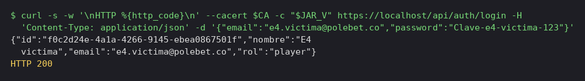
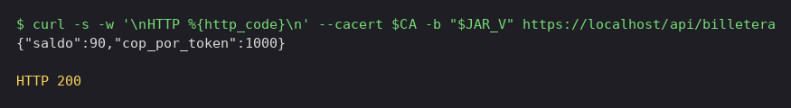
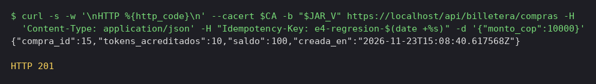
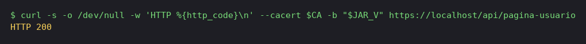
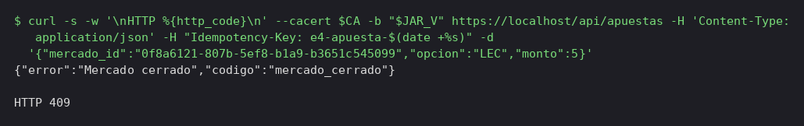
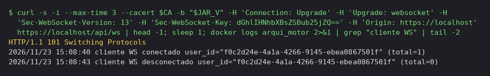
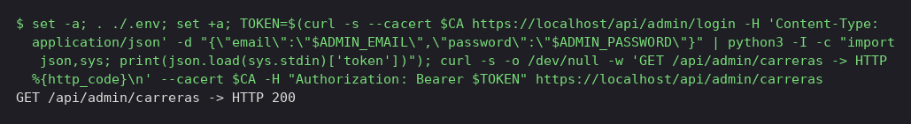
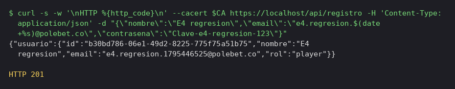

> **Nota sobre R5.** Las carreras simuladas que había en la base ya terminaron y
> sus mercados están cerrados. Una apuesta aceptada requiere programar una
> simulación nueva desde la CLI; para la autenticación basta ver que la apuesta
> ya no se corta en 401 sino en la regla de negocio del Motor/Pagos.

---

## Resumen antes / después

| # | Ataque | Antes | Después |
|---|---|---|---|
| A3–A5 | `X-User-Id` a mano → Orquestador | 200 / 200 / 201 | 401 |
| A6 | Lo mismo desde Pagos | 200 | 401 |
| A8 | `X-User-Id` a mano → WebSocket del Motor | 101 | 401 |
| B2 | Cookie fabricada con el secreto del Motor, por el Gateway público | 200 | 401 (el Motor no tiene secreto) |
| C1 | Token propio con el `sub` de la víctima | — | 401 |
| C2 | Token firmado con otra llave Ed25519 | — | 401 |
| C3 | `alg: none` | — | 401 |
| C4 | HS256 con el `JWT_SECRET` real | — | 401 |
| C5 | Token real reusado a los 61 s | — | 401 (200 dentro del minuto) |
| C6 | Token alterado → WebSocket | — | 401 |
| D2 | Motor → Usuarios con sus tokens | 200 | 401 |
| D3 | Pagos → Usuarios con sus tokens | 200 | 401 |
| D4 | Pagos → Motor con sus tokens | — | 401 |
| D5 | Usuarios → Pagos con su token | — | 401 |
| D6 | Orquestador → Usuarios con el token de otro destino | — | 401 (con el suyo, 200) |
| D8 | Dos tokens iguales en un servicio | — | no arranca |
